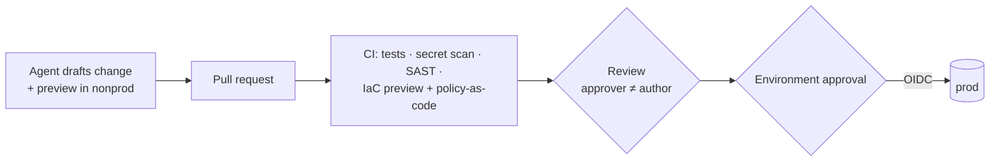

# Papaya: DevSecOps with Coding Agents

This is the deliverable for DevSecOps Challenge 1. It is a high-level framework and workflow for how Papaya uses coding agents (Claude Code) for DevSecOps, designed to meet ISO 27001 and HIPAA at a cost a small team can carry.

## Summary

> **Agents and humans freely *propose* and *observe*. Only a pipeline *changes* production, from Git, after a named person who is not the author approves it.**

| | Engineering gets | Compliance gets |
|---|---|---|
| **Debugging** | Direct, read-only access to prod for agents: self-service, 1 hour, ticket required | Reads aren't changes; every call is logged, attributed and reviewed weekly |
| **Shipping changes** | Agents write and preview the change; the PR is validated automatically | A named approver who isn't the author, plus an environment approval; the pipeline deploys |
| **Incidents** | One-click runbooks and a 15-minute fast lane for hotfix PRs | A second approver on every runbook; break-glass needs 2 approvers and is reconciled within 48h |
| **Cost and effort** | One AWS account, two environments, no SIEM, no paid access broker | Audit logs under Object Lock, real-time alerts, signed weekly review |

Building it takes about **8–11 engineer-weeks**. Infrastructure runs about **$1.7k–6.2k/year**.

---

## 1. Context and goal

Papaya runs a GenAI insurance platform that handles PHI: medical documents, diagnoses, national IDs and bank accounts. Every engineer works agent-first with Claude Code. Today, though:
- laptops can reach production through SSO;
- some engineers turn permission prompts off;
- MCP servers and plugins go unreviewed;
- CI uses long-lived keys;
- monitoring is fragmented.

Papaya is pursuing **ISO 27001** and must meet **HIPAA**.

Two views have to be reconciled:
- **Engineering:** *"Let Claude Code talk to AWS directly so I can debug and ship without waiting."*
- **Compliance:** *"Nothing changes in production without a named person who reviewed and approved it."*

**Goal:** a framework that keeps agent-speed delivery, satisfies Compliance, and stays simple and cheap enough for a small team.

## 2. The answer

> **Agents and humans freely *propose* and *observe*. Only a pipeline *changes* production, from Git, after a named person who is not the author approves it.**

Compliance's requirement is about **changes**, so observing and changing can be governed differently:

| Activity | Who | Control | Engineering gets | Compliance gets |
|---|---|---|---|---|
| **Propose:** code, IaC, config | Engineer + agent | CI checks + review before merge | Agents work freely; full rights in nonprod | Nothing reaches prod unreviewed |
| **Observe:** debug prod | Engineer or agent, self-service, 1 hour, ticket | **Detective**: logged, attributed, reviewed weekly | Direct, read-only AWS access in under a minute | Reads aren't changes, and every read is visible |
| **Change:** deploy, restart, redrive | **Pipeline only** (OIDC) | **Preventive**: PR or runbook + approval (approver ≠ author) | Fast lanes: 15-minute hotfix review, one-click runbooks | A named approver for every prod change, recorded by GitHub |
| **Emergency** | Human only (break-glass) | 2 approvers + alert + postmortem + reconciliation PR within 48h | A way out when the pipeline can't help | HIPAA emergency access without a standing back door |

## 3. Operating model

**Principles**
1. **Git is the single source of truth** for every prod change. The only two exceptions are secret values and break-glass.
2. **Pipelines change prod; people and agents don't.**
3. **The approver is never the author.** GitHub enforces this.
4. **Agents never grant themselves privileges.** They have no IAM write rights, and nonprod roles carry a permission boundary.
5. **The Rule of Two:** in one session, an agent has at most two of untrusted input, sensitive access, and the ability to change state.
6. **Deterministic controls beat prompts.** IAM, settings and hooks enforce; instructions only guide.
7. **Secret values and PHI never enter an agent's context.**
8. **Simple enough for a small team:** one AWS account, two environments, no SIEM, no paid broker.

**Environments:** `nonprod` and `prod` live in **one AWS account**, separated by VPC, naming (`<env>-<service>-<name>`, SSM `/<env>/<service>/<name>`) and tags. Nonprod holds **test data only**. In place of separate accounts, five compensating layers do the isolation:
- an IAM deny on `prod-*`;
- an IAM escalation guard;
- VPC endpoint resource policies on PHI data;
- per-environment KMS keys;
- quota isolation.

**Identities**

| Identity | Rights on prod |
|---|---|
| Engineers / agents (default) | None (deny-prod), full in nonprod |
| `prod-debug` / `prod-debug-agent` | Read-only; no secrets, no PHI. Self-service for 1h with a ticket |
| Pipelines (`deploy`, `ops`) | Write, only through PR or runbook approval |
| `prod-breakglass` | Admin, humans only, 2 approvers |

## 4. Core workflows

**4.1 Shipping a change**

Persistent incident changes (scale, config, flags) use the same path with a **`hotfix-ops` fast lane** (on-call reviewer, 15-minute SLA).

**4.2 Debugging prod:** the engineer self-activates `prod-debug-agent` with a ticket. The agent then investigates read-only (logs, metrics, describe calls) and **can't write**. A fix becomes a PR or runbook parameters in a new session.

**4.3 Operating prod:** one-off actions run as **runbooks-as-code**. These are workflows in the repo: restart service, redrive DLQ, invalidate CDN, rerun Step Functions, rollout restart. A human triggers the runbook, a second person approves it, and a narrowly scoped pipeline role executes it. Agents may prepare the command but never trigger it.

**4.4 Emergency:** break-glass needs 2 approvers and raises an instant alert. A human acts, never an agent. The change must be reconciled in a PR within 48h, followed by a postmortem and a quarterly test.

## 5. Guardrails for coding agents

| Layer | Control | Bypassable by the engineer? |
|---|---|---|
| Cloud permissions | IAM, resource and KMS policies | No (the real boundary) |
| Managed settings | Bypass mode disabled, managed-only rules/hooks/MCP, plugin marketplace allowlist, sandbox, forced org login | No |
| Guardrail hook | Blocks prod-mutating commands, secret reads, pushes to `main`, settings edits | No |
| Sandbox | Filesystem and network allowlist | No |
| Conventions | `CLAUDE.md` + skills (naming, PRs, debugging, runbooks) | Guidance only |
| Telemetry | Claude Code OpenTelemetry with prompts redacted | No |

- **MCP servers and plugins:** nothing runs until it is reviewed. Each review records the owner, the data accessed, write capability, a Rule of Two assessment and the pinned version. Only the internal marketplace is trusted.
- **Guardrails live in a separate repo:** `agent-platform`, with platform + security reviewers and ring rollout. An agent working in the app repo can't edit its own guardrails.
- **PHI gate:** agents don't read PHI until a BAA covers the Claude Code channel. That means Anthropic Enterprise with the HIPAA configuration, or Bedrock under the AWS BAA.
- **Production AI agents** (claims, FWA, documents) read untrusted partner documents. They produce recommendations, and claim-state changes go through a rule engine or a human step.

## 6. Logging, detection and evidence (no SIEM)

ISO 27001 and HIPAA require Papaya to **record, protect, review and respond**. A SIEM isn't required.

- **Record and protect:** CloudTrail (plus S3 data events on PHI buckets), GCP, k0s, GitHub and Claude Code audit logs go to **S3 with Object Lock** for 6 years, queried with Athena.
- **Detect:**
  - **Real-time** EventBridge alerts to Slack and Linear for: prod changes outside the pipeline, IAM escalation, secret changes, break-glass use, and prod data copied to nonprod.
  - **Hourly and daily** queries for AccessDenied spikes and agent configuration drift.
  - **GuardDuty** for threats.
  - **Prowler** (open source) weekly against HIPAA and ISO 27001.
- **Review:** an automatically generated **weekly report**, signed off by a reviewer through a PR, plus a monthly evidence pack (approval rates, out-of-pipeline changes, break-glass, posture, access list).

## 7. Compliance coverage (summary)

| Requirement | Met by |
|---|---|
| ISO A.8.32 Change management | PR + approver ≠ author + environment approval; runbooks; break-glass reconciliation |
| ISO A.8.2 Privileged access · A.5.15/A.5.18 Access control and rights | No standing prod write; JIT with expiry; break-glass with 2 approvers; quarterly access review |
| ISO A.8.31 Separation of environments · A.8.33 Test information | VPC + naming/tag deny + boundary + KMS; test data only in nonprod |
| ISO A.8.15/A.8.16 Logging and monitoring | Object Lock audit logs; real-time detections; signed weekly review |
| ISO A.5.17/A.8.24 Secrets and cryptography | Vault + rotation; per-environment KMS; no secrets in Git or agent context |
| ISO A.5.23 Cloud services · A.8.19 Software installation | Managed settings; reviewed MCP/plugin allowlist; pipeline-only deploys |
| HIPAA 164.312(a) Access control, unique user ID, emergency access | Per-person SSO; separate agent identity; break-glass procedure |
| HIPAA 164.312(b) Audit controls · 164.308(a)(1)(ii)(D) Activity review | CloudTrail + PHI data events; weekly review sign-off |
| HIPAA 164.308(a)(6) Incident procedures | Alerts → incident → runbook → postmortem |
| OWASP LLM/Agentic (prompt injection, excessive agency, supply chain) | Rule of Two, read-only debug, no agent prod writes, allowlisted MCP/plugins |

## 8. Key decisions and trade-offs

| Decision | Why | Trade-off | Revisit when |
|---|---|---|---|
| Pipelines-only prod changes | Satisfies Compliance without blocking agents | Prod changes wait for a reviewer (mitigated by fast lanes) | — |
| Single AWS account | Small team; multi-account adds overhead | Isolation depends on IAM quality (5 layers, 2-person review) | Partner requires isolation, multiple prod teams, audit finding |
| Git as source of truth, including ops | No human prod write role; full traceability | Runbook library to maintain | Compliance wants every operation committed |
| No SIEM | Not required; ~70–95% cheaper | No real-time correlation; relies on the weekly review | >10 GB/day logs, SOC team, auditor demand |
| Separate governance repo | Separation of duties for guardrails | Two repos to maintain | — |
| No PHI to agents yet | BAA scope is unconfirmed on the current plan | Agents can't help with PHI-level debugging | Enterprise + HIPAA config, or Bedrock under the AWS BAA |
| AWS TEAM as JIT broker | Free, native | Approvals are web-only | Slack approval or conditional approval needed |

These choices come from a review of five big-tech models (Google Zero-Touch Prod, AWS pipelines + JIT, Microsoft SFI/PIM, GitOps + policy-as-code, agent containment) and three candidate solutions. See [`research/`](research/).

## 9. Roadmap, metrics and cost

| Phase | Weeks | Outcome |
|---|---|---|
| 0: Stop the bleeding | 1–2 | Managed agent settings live; no laptop can write to prod; no long-lived CI keys; BAA decision |
| 1: Gated change path + audit logging | 3–6 | Rulesets, environments, policy-as-code; isolation layers; read-only debug; real-time alerts |
| 2: Operations without human write | 7–10 | Runbooks, fast lane, break-glass tested; weekly review and Prowler live |
| 3: Hardening | Months 3–6 | Production AI agents reviewed against the Rule of Two; internal ISO pre-audit |

**Targets:**
- 0 laptops with prod write access.
- 0 long-lived CI keys.
- 0 sessions in bypass mode.
- 100% of prod changes with approver ≠ author.
- 0 out-of-pipeline changes.
- ≥ 98% of debug sessions with a ticket.
- 100% of weekly reviews signed off.

**Effort and cost:**
- About **8–11 engineer-weeks** to build.
- About 2–3 h/week to run, plus a 30–45 minute weekly review.
- Infrastructure about **$1.7k–6.2k/year**.

## Agent session (public links)

The full, unedited Claude Code conversation for this challenge is public in this repository:

| Session | Public link |
|---|---|
| Main session (orchestrator) | [50a70d1f-189e-47aa-85ec-2484b354247f.jsonl](https://github.com/minhhieu16/DevSecOps_Challenge/blob/main/sessions/50a70d1f-189e-47aa-85ec-2484b354247f.jsonl) · [raw](https://github.com/minhhieu16/DevSecOps_Challenge/raw/main/sessions/50a70d1f-189e-47aa-85ec-2484b354247f.jsonl) |
| Sub-agents of the main session | [sessions/50a70d1f-189e-47aa-85ec-2484b354247f/subagents/](https://github.com/minhhieu16/DevSecOps_Challenge/tree/main/sessions/50a70d1f-189e-47aa-85ec-2484b354247f/subagents) |
| Forked session (logical challenge formatting) | [81d85be5-5348-4f12-b37a-a4757714f1b3.jsonl](https://github.com/minhhieu16/DevSecOps_Challenge/blob/main/sessions/81d85be5-5348-4f12-b37a-a4757714f1b3.jsonl) · [raw](https://github.com/minhhieu16/DevSecOps_Challenge/raw/main/sessions/81d85be5-5348-4f12-b37a-a4757714f1b3.jsonl) |
| All sessions | [sessions/](https://github.com/minhhieu16/DevSecOps_Challenge/tree/main/sessions) |

## 10. Repository

| Path | Content |
|---|---|
| [research/](research/) | The analysis behind this framework: top 5 big-tech models, top 3 solutions with trade-offs, principal review, monitoring cost comparison |
| [sessions/](sessions/) | Raw, unedited Claude Code session transcripts (main session plus every sub-agent) |
| [logical-challenge/](logical-challenge/) | Logical challenge answers ([Markdown](logical-challenge/Logical_challenge.md) and [original text](logical-challenge/raw/Logical_challenge.txt)) |

**Assumptions**
- There was no access to Papaya systems. Names, volumes and costs are estimates (account `111122223333`, region `ap-southeast-1`).
- Facts were checked against primary sources where possible. The remaining open items are listed in [research/01 Appendix B](research/01-bigtech-models-and-top3-solutions.md#appendix-b--verification-status).

**How this was built:** Claude Code orchestrated the work. Sonnet and Haiku sub-agents handled parallel research and fact-checking, and the author directed and reviewed each key decision (single account, Git as source of truth, no SIEM, governance repo, test data only in nonprod).
