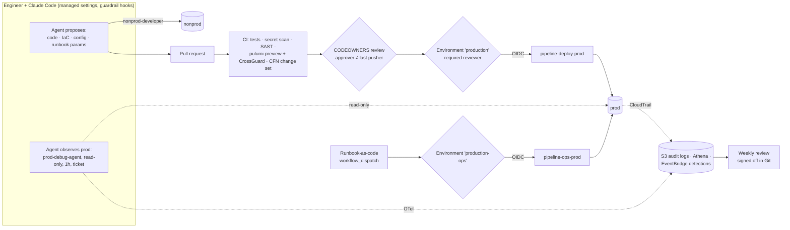

# 01 — Operating Model: How Papaya Uses Coding Agents for DevSecOps

> Status: Proposed v1.0 · Owner: DevSecOps · Applies to: every engineer and every coding agent (Claude Code) working on Papaya systems.

## 1. The problem in one line

Engineering wants agents to **debug and ship infra changes without waiting**. Compliance wants **no production change without a named person who reviewed and approved it**. Papaya processes PHI (medical documents, diagnoses, national IDs, bank accounts) and is pursuing **ISO 27001** and **HIPAA**.

## 2. The answer in one line

> **Agents and humans may freely *propose* and *observe*. Only a pipeline *changes* production, from Git, after a named person who is not the author approves it.**

Compliance's requirement is about **changes** ("nothing *changes* in production…"). That word lets us split the two needs:

| Activity | Who | Control type | Why it satisfies both sides |
|---|---|---|---|
| **Propose:** write code, IaC, config, runbook parameters | Engineer + agent, anywhere | Preventive at merge time (CI, CODEOWNERS) | Engineering moves at agent speed; nothing reaches prod without review |
| **Observe:** debug prod, read metrics, logs, describe resources | Engineer or agent, self-service, 1 hour | **Detective**: every call is logged, attributed and reviewed weekly | Engineering doesn't wait; reads are not changes |
| **Change:** deploy, restart, redrive, scale, rotate | **Pipeline only** (GitHub Actions via OIDC) | **Preventive**: PR or runbook with an environment approval (approver ≠ last pusher) | Compliance gets a named approver for every prod change, recorded by GitHub |
| **Emergency** | Human only, break-glass | Preventive (2 approvers) + detective + postmortem + reconciliation PR | Meets HIPAA *Emergency access procedure* without a standing back door |

## 3. Principles

| # | Principle | Practical meaning |
|---|---|---|
| P1 | **Git is the single source of truth** | Every prod change is a commit or a runbook defined in the repo. There are two documented exceptions: secret *values* and break-glass |
| P2 | **Pipelines change prod; people and agents don't** | No human or agent identity has prod write rights, except break-glass |
| P3 | **Approver ≠ author** | GitHub rulesets and environments enforce it ("most recent push" approval, prevent self-review). An agent's PR is approved by someone other than the engineer who drove the agent |
| P4 | **Agents never grant themselves privileges** | Humans and agents have no IAM writes at all. Roles are created by the pipeline, and nonprod roles carry a permission boundary |
| P5 | **Agents follow the Rule of Two** | In one session an agent has at most two of: [A] untrusted input, [B] sensitive data/systems, [C] state change or external communication |
| P6 | **Deterministic controls beat prompts** | IAM, resource policies, KMS key policies, managed settings and hooks enforce rules. Instructions in CLAUDE.md only guide behaviour |
| P7 | **Secret values and PHI never enter an agent's context** | Agents work with references (ARNs, names), never with values. A secret pasted into a prompt is treated as leaked and rotated |
| P8 | **Everything is observable and attributable** | Every action traces back to a person (SSO), an agent session (separate permission set + OTel), a ticket and a Git commit |
| P9 | **Simple enough for a small team** | One AWS account, two environments, no SIEM, no paid access broker. Self-managed, open-source or near-free components |

## 4. Environments

| | `nonprod` | `prod` |
|---|---|---|
| Where | Same AWS account, **nonprod VPC** | Same AWS account, **prod VPC** (no peering) |
| Naming | `nonprod-<service>-<name>`, SSM `/nonprod/<service>/<name>` | `prod-<service>-<name>`, SSM `/prod/<service>/<name>` |
| Data | **Synthetic or de-identified only** | Real PHI/PII |
| Humans and agents | Broad rights (`nonprod-developer`) | Read-only debug (`prod-debug`, `prod-debug-agent`); no writes |
| Deploys | Pipeline, automatic on merge | Pipeline, after `production` environment approval |

A single account was chosen deliberately for team size (see [ADR-002](10-decisions.md#adr-002-single-aws-account-separated-by-vpc-and-naming)). The isolation comes from five compensating layers ([02-access-model.md §4](02-access-model.md#4-compensating-controls-for-a-single-account)).

## 5. The workflow at a glance

## 6. Roles and responsibilities (RACI)

| Activity | Engineer | Coding agent | Reviewer (CODEOWNER) | On-call | Platform/DevSecOps | Security/DPO | Compliance |
|---|---|---|---|---|---|---|---|
| Write code/IaC/config | R/A | R (drafts) | — | — | C | — | — |
| Approve prod change (PR + environment) | — | ✗ never | **R/A** | — | C | C (sensitive paths) | I |
| Debug prod (read-only) | R/A | R (with `prod-debug-agent`) | — | R | — | I (weekly review) | — |
| Trigger a runbook | R | ✗ (prepares params only) | — | R | — | — | — |
| Approve a runbook | — | ✗ | — | **A** (≠ trigger) | C | — | I |
| Break-glass | R | ✗ never | — | R | A (approver 1) | A (approver 2) | I |
| Maintain guardrails (`agent-platform`) | C | R (drafts PRs) | — | — | **R/A** | A (2nd approval) | C |
| Weekly review sign-off | — | — | — | — | R | **A** | I |
| Approve a new MCP server or plugin | C (requester) | — | — | — | R | **A** | I |
| Incident response | R | assists read-only | — | **A** | R | R (if PHI) | I |

R = responsible · A = accountable · C = consulted · I = informed · ✗ = not allowed.

## 7. What changes for each group

- **Engineers:**
  - Keep using Claude Code everywhere. Agents can do anything in nonprod.
  - Prod access is read-only and self-service with a ticket.
  - Changes go through a PR, with a 15-minute fast lane for incidents.
  - Operations go through one-click runbooks.
- **Compliance:**
  - Every prod change has a named approver in GitHub.
  - Every elevation is logged and time-boxed.
  - Weekly reviews are signed off in Git.
  - A monthly evidence pack is generated automatically.
- **Security:**
  - Guardrails are code in one repo, with two-person review.
  - Critical events alert in real time.
  - Posture is scanned weekly against HIPAA and ISO 27001 (Prowler).
- **Partners:** PHI never leaves Papaya's AWS/GCP accounts through agents. Agents don't read PHI until the BAA question is settled ([ADR-006](10-decisions.md#adr-006-agents-do-not-read-phi-until-the-baa-is-in-place)).
