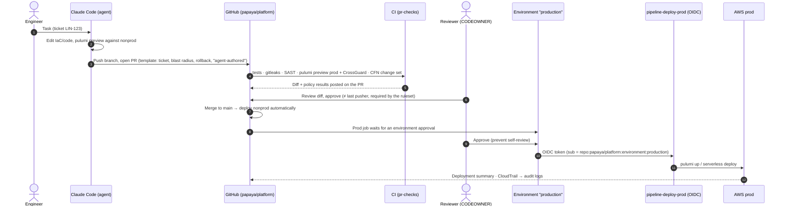

# 03 — Change Workflow: Git as the Single Source of Truth

> Implements: ISO 27001 A.8.9, A.8.25, A.8.28, A.8.32 · HIPAA 164.312(b), 164.308(a)(1)
> Artifacts: [`monorepo-examples/.github/`](../monorepo-examples/.github/) · [`agent-platform/policies/crossguard/`](../agent-platform/policies/crossguard/) · [`agent-platform/policies/github/`](../agent-platform/policies/github/)

## 1. Classes of change

| Change | Path | Approval | Executed by |
|---|---|---|---|
| Code, IaC (Pulumi, Serverless), config, feature flags, IAM, k8s manifests | **PR** → CI → merge | CODEOWNERS review (approver ≠ last pusher) + Environment `production` | `pipeline-deploy-prod` / Argo CD sync |
| **Persistent change during an incident** (scale, timeout, flag) | **PR labelled `hotfix-ops`** (fast lane: on-call reviewer, 15-minute SLA, minimal CI) | 1 reviewer ≠ author + Environment `production` | `pipeline-deploy-prod` |
| **Transient operation** (restart, redrive DLQ, invalidate CDN, rerun Step Functions, rollout restart) | **Runbook-as-code** (`ops-*` workflow, `workflow_dispatch` with ticket) | Environment `production-ops` (required reviewer, prevent self-review) | `pipeline-ops-prod` (only that runbook's actions) |
| Secret **definition** (name, KMS key, policy, rotation) | PR | CODEOWNERS platform + security | `pipeline-deploy-prod` |
| **Exception 1:** secret **value** | Never in Git. Machine secrets rotate automatically; third-party values go through `prod-secret-intake` | Approver ≠ requester | A human pastes it into the vault ([06](06-secrets-and-config.md)) |
| **Exception 2:** break-glass | Not via Git at the time of use | 2 approvers | A human, then a **reconciliation PR within 48h** ([05](05-debug-and-incident.md)) |

**Rule of thumb:** if the change should still be true tomorrow, it's a PR. If it is a one-off action that doesn't change desired state, it's a runbook. Everything else is break-glass.

## 2. The standard path (PR → prod)

### Controls on the path

| Step | Control | Fails closed if… |
|---|---|---|
| Push | Push protection + gitleaks | A secret pattern is found |
| PR checks | Unit/integration tests, SAST, `pulumi preview` + **CrossGuard mandatory** (naming, tags, encryption, no secrets in env vars, nonprod boundary, no `*:*` IAM), Serverless CloudFormation change set | A test fails or a mandatory policy is violated |
| Review | Ruleset on `main`: PR required, code-owner review, **"Require approval of the most recent reviewable push"**, stale approvals dismissed, no force push | The approver pushed the last commit, or no code owner approved |
| Prod deploy | Environment `production`: required reviewers, **prevent self-review**, `main` only | The person who triggered it tries to approve |
| Credentials | OIDC role with strict `sub`; no long-lived keys anywhere in CI | The workflow doesn't come from the right repo and environment |

### Agent-authored PRs

- The agent pushes to a feature branch and **never to `main`**. Force push and push to `main` are blocked by the ruleset and also by the guardrail hook.
- The PR template asks "authored with a coding agent?". It is disclosure, not a lower bar.
- The engineer who drove the agent counts as the author. **Someone else approves.**
- Keep PRs small. Reviewers may reject large agent-generated diffs without reading them.

## 3. Runbooks-as-code (operations without a human write role)

| Runbook | Action (and nothing else) | Target validation |
|---|---|---|
| `ops-restart-service` | `ecs:UpdateService --force-new-deployment` | Service name matches `prod-*` |
| `ops-redrive-dlq` | `sqs:StartMessageMoveTask` | Source queue matches `prod-*-dlq` |
| `ops-invalidate-cdn` | `cloudfront:CreateInvalidation` | Distribution tagged `env=prod` |
| `ops-rerun-stepfn` | `states:StartExecution` with the same input | State machine matches `prod-*` |
| `ops-k8s-rollout-restart` | `kubectl rollout restart` | Namespace matches `prod-*` |

**Flow:**
1. On-call picks the runbook in GitHub, fills in target, ticket and reason, and runs it. An agent may *prepare* the exact `gh workflow run` command, but a human triggers it.
2. Environment `production-ops` pauses for an approver who isn't the trigger.
3. `pipeline-ops-prod` runs the single action and writes a job summary: actor, approver, ticket, target, result.

Typical wall-clock time is 1–2 minutes, with approval from GitHub mobile. A missing runbook during an incident is a finding for the weekly review: add it through a PR.

**Stricter variant** (if Compliance requires every operation in commit history): an "ops request" YAML committed through a PR triggers the runbook on merge.

## 4. Drift and reconciliation

- Pulumi drift detection (refresh in a scheduled job) and the weekly review flag differences between Git and prod.
- Changes made through **break-glass** must be reconciled within **48 hours**: either codify them in a PR or revert them. DET-009 escalates otherwise.
- Runbook actions don't create drift by design, because they never change desired state.

## 5. Governance repo changes

Changes to guardrails ([`agent-platform`](../agent-platform/)) follow the same path with stricter rules:
- **2 approvals** (platform + security) for `policies/`, `managed-settings/`, `detections/`.
- Environment `governance` for deploys.
- Ring rollout: the platform team first, then everyone.
