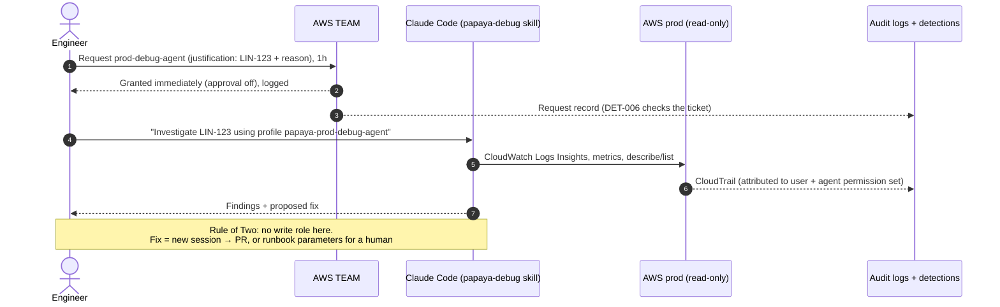

# 05 — Debugging, Incidents and Break-glass

> Implements: ISO 27001 A.5.24–A.5.28, A.8.16 · HIPAA 164.308(a)(6), 164.312(a)(2)(ii), 164.312(b)
> Artifacts: [`papaya-debug` skill](../agent-platform/marketplace/plugins/papaya-debug/) · [`ops-*` runbooks](../monorepo-examples/.github/workflows/) · [`detections/`](../agent-platform/detections/)

## 1. Debugging prod (read-only, self-service, observed)

**Rules:**
- Agents use **only** `prod-debug-agent`, and humans use `prod-debug`. One ticket per session.
- Reads of secrets, PHI buckets, PHI log groups and decryption are **denied by IAM**. The hook also blocks the commands, so the agent doesn't keep retrying.
- After debugging, act through the normal paths: a PR (persistent change, `hotfix-ops` lane if urgent) or a runbook (transient operation).
- Every session appears in the **weekly review** (who, human or agent, ticket, duration, calls).

## 2. Incident flow

| Phase | What happens | Tooling |
|---|---|---|
| Detect | EventBridge real-time rule, GuardDuty finding, application alarm, partner report | SNS → Slack `#sec-alerts` / on-call |
| Triage | On-call opens a Linear incident (`SEC-…`). Severity: SEV1 = PHI exposure or prod down; SEV2 = degraded; SEV3 = minor | Linear |
| Investigate | Read-only `prod-debug` / `prod-debug-agent` with the incident ticket | TEAM, Claude Code, Athena over audit logs |
| Mitigate | **Runbook** (restart, redrive, invalidate, rerun, rollout restart) or a **`hotfix-ops` PR** (scale, config, flag). Break-glass only if neither works | GitHub environments `production-ops` / `production` |
| Recover | Verify metrics, close the mitigation | — |
| Learn | Blameless postmortem within 5 working days. Missing runbooks and detections become PRs | `agent-platform/evidence/postmortems/` |

**PHI involvement (possible breach):**
- Security/DPO joins immediately.
- Preserve logs; Object Lock already prevents deletion.
- Follow the HIPAA breach assessment and partner notification clauses. Contractual timelines differ per partner and country (VN/TH/HK), so keep a per-partner contact and notification matrix.

## 3. Break-glass

Break-glass is used when Git or the pipeline path is unavailable or too slow for a SEV1 (GitHub outage, broken pipeline, an action no runbook covers).

| Step | Detail |
|---|---|
| 1. Request | TEAM `prod-breakglass`, justification = SEV1 incident ticket |
| 2. Approve | **2 approver groups** (Platform + Security); neither may be the requester |
| 3. Alert | DET-004 fires in real time to `#sec-alerts` and the security on-call |
| 4. Act | A human acts in the console or CLI, minimal and recorded. **Never through a coding agent** (the hook blocks the break-glass profile) |
| 5. Expire | The session ends after 1 hour; extending it requires a new request |
| 6. Reconcile | A PR that codifies or reverts every change, **within 48 hours** (DET-009 escalates) |
| 7. Review | Postmortem + appears in the weekly review |
| 8. Test | An end-to-end exercise every quarter (HIPAA *Emergency access procedure* is a **Required** specification) |

## 4. On-call

- **Rotation:** weekly, primary + secondary, from platform and backend engineers who have done the onboarding dry-run.
- **Duties:**
  - Respond to Critical alerts (target < 15 minutes).
  - Approve runbooks triggered by others.
  - Act as the fast-lane reviewer for `hotfix-ops` PRs.
- **Handover:** a Slack thread summary plus open incidents, every Monday after the weekly review.
