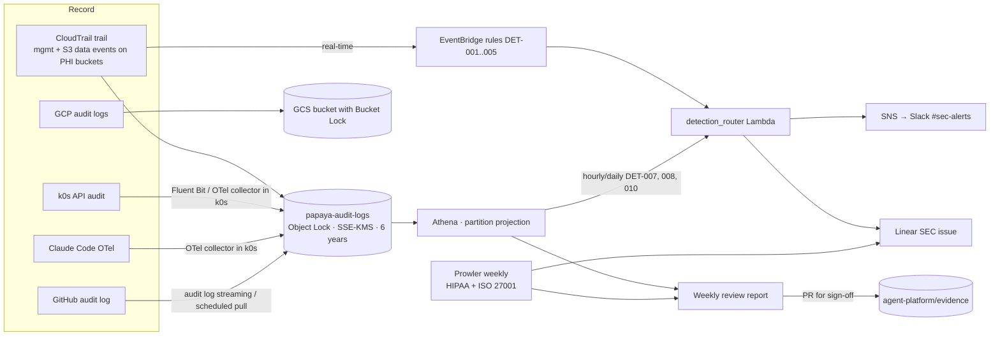

# 07 — Logging, Detection and Evidence (no SIEM)

> Implements: ISO 27001 A.8.15, A.8.16, A.8.17, A.5.25, A.5.28 · HIPAA 164.312(b), 164.308(a)(1)(ii)(D), 164.308(a)(6)
> Artifacts: [`agent-platform/detections/`](../agent-platform/detections/) · [`weekly-review.yml`](../agent-platform/.github/workflows/weekly-review.yml) · [`prowler-weekly.yml`](../agent-platform/.github/workflows/prowler-weekly.yml) · [`evidence/`](../agent-platform/evidence/)
> Cost analysis: [research/02-siem-cost-comparison.md](../../research/02-siem-cost-comparison.md)

## 1. Why no SIEM

ISO 27001 and HIPAA require Papaya to **record** activity, **protect** the records, **review** them regularly, **respond** to incidents and **keep evidence**. They don't require a SIEM product. For a small team, a self-managed pipeline meets those requirements at roughly **$1.7k–6.2k/year** (recommended tier), against ~$5k–17k/year for an AWS-native SIEM stack ([ADR-004](10-decisions.md#adr-004-no-siem-self-managed-audit-logging)).

## 2. Architecture

## 3. What is recorded

| Source | Scope | Retention |
|---|---|---|
| CloudTrail | All management events (first trail is free) + **S3 data events on PHI buckets only** | S3 Object Lock, 90 days Standard → IA → Glacier Deep Archive, **6 years** |
| GCP | Admin Activity (always on) + Data Access for prod projects → sink to GCS | GCS Bucket Lock, 6 years |
| k0s | API server audit at Metadata level (filtered: no get/list/watch from system service accounts) | S3 `k0s/`, 6 years |
| GitHub | Org audit log + workflow runs + environment approvals | S3 `github/`, 6 years |
| Claude Code | OTel events (`tool_decision`, `tool_result`, version, settings). **Prompts redacted** (default) | S3 `otel/claude-code/`, 1 year |
| Not sent | VPC Flow Logs (GuardDuty analyses them itself) | — |

The 6-year retention is a conservative alignment with HIPAA documentation retention (164.316(b)(2)). ⚠️ Confirm the interpretation with Compliance.

## 4. Detection catalogue

| ID | Detection | Engine | Latency | Severity |
|---|---|---|---|---|
| DET-001 | Prod change outside the pipeline | EventBridge → Lambda | Real-time | Critical |
| DET-002 | IAM escalation (role/policy without `nonprod-boundary`, outside `pipeline-deploy-prod`) | EventBridge → Lambda | Real-time | Critical |
| DET-003 | Secret/parameter changed outside the flow | EventBridge → Lambda | Real-time | Critical |
| DET-004 | Break-glass used | EventBridge → Lambda | Real-time | High |
| DET-005 | Prod snapshot copy/share or replication to nonprod | EventBridge → Lambda | Real-time | Critical |
| DET-006 | Debug session without a ticket | Lambda on TEAM request | Real-time | High |
| DET-007 | Agent AccessDenied on secrets/PHI/KMS | Athena hourly | ≤ 1h | High |
| DET-008 | AccessDenied spike per identity | Athena hourly | ≤ 1h | Medium |
| DET-009 | Break-glass not reconciled within 48h | Daily Lambda | Daily | Medium |
| DET-010 | Claude Code drift (bypass, MCP not allowlisted, old version) | Athena daily on OTel | Daily | Medium |
| DET-011 | Naming/tag violations | CrossGuard (PR) + Prowler custom check | Weekly | Medium |
| DET-012 | Posture fails vs HIPAA/ISO 27001 | Prowler | Weekly | By check |
| — | GuardDuty findings | GuardDuty → EventBridge → Slack | Minutes | By finding |

The full definitions, SQL and patterns are in [`agent-platform/detections/`](../agent-platform/detections/).

## 5. Review: the weekly review is the control

- **Every Monday**, `weekly-review.yml` runs the Athena queries and opens a PR in `agent-platform` with `evidence/weekly/<YYYY>-W<ww>.md`.
- **The report covers:**
  - Debug sessions (who, human or agent, ticket, duration).
  - Break-glass and its reconciliation status.
  - Runbook runs and approvers.
  - Critical/High alerts and how they were handled.
  - The AccessDenied trend.
  - New Prowler failures.
- **The reviewer** (rotating platform + security, 30–45 minutes) investigates anomalies, links follow-up tickets and **approves the PR**. The merged PR is the evidence for HIPAA *Information system activity review* and ISO A.8.16.
- **A missed week is an audit finding.** The review is tracked as a metric.

## 6. Monthly evidence pack (generated automatically)

| Item | Source |
|---|---|
| % of prod changes with approver ≠ last pusher | GitHub API (PRs + environment deployments) |
| Out-of-pipeline prod changes (target 0) | Athena (CloudTrail) |
| Break-glass sessions and reconciliation | TEAM + DET-009 |
| Prowler HIPAA and ISO 27001 reports | Prowler outputs in S3 |
| Access list for prod permission sets | Identity Center export |
| Weekly reviews signed off | `evidence/weekly/` merged PRs |

The pack is stored under `s3://papaya-audit-logs/evidence/monthly/` (Object Lock) with a summary committed to `agent-platform/evidence/monthly/`.

## 7. Metrics

| Metric | Target |
|---|---|
| Prod changes from Git with approver ≠ last pusher | 100% |
| Out-of-pipeline prod changes (excluding break-glass) | 0 |
| Break-glass reconciled within 48h | 100% |
| Debug sessions with a valid ticket | ≥ 98% |
| Median debug session | < 1h |
| Critical alert acknowledgement | < 15 minutes |
| Weekly reviews signed off | 100% |
| Prowler critical/high fails open > SLA (7 / 30 days) | 0 |

## 8. Cost (Singapore, estimated)

| Tier | Small (~50 engineers) | Medium (~150 engineers) |
|---|---|---|
| Minimum (CloudTrail data events, S3, Athena, Lambda/EventBridge, Prowler on Actions, collectors on k0s) | ~$0.3k/year | ~$1.2k/year |
| **Recommended** (+ GuardDuty, + Macie quarterly on nonprod) | **~$1.7k/year** | **~$6.2k/year** |

Build effort is ~2–3 engineer-weeks; run effort is ~2–3 h/week plus the weekly review. Re-evaluate a SIEM if any of these appear:
- More than 10 GB/day of logs.
- More than 25 correlation rules.
- A dedicated SOC.
- More than 4 h/week of glue maintenance.
- An auditor or partner requires one.
