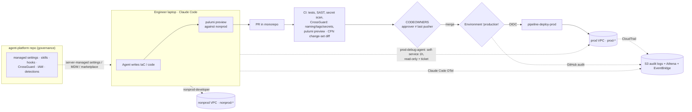
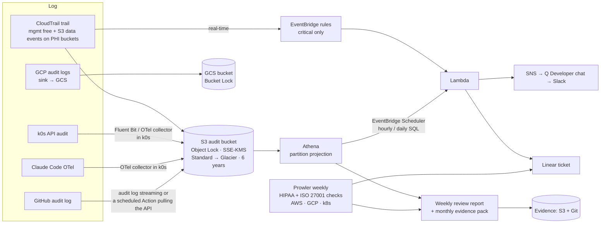

# Papaya — Coding Agents for DevSecOps: Big-Tech Models & Top 3 Solutions

> Role: Principal DevSecOps · Version: **v3.3** · Date: 2026-11-06
> Method: 5 research sub-agents (3× Sonnet, 2× Haiku) → orchestrator synthesis → fact-check sub-agents against primary sources → revisions with the candidate's input.
> Verification status of every non-obvious claim is in [Appendix B](#appendix-b--verification-status). Remaining ⚠️ items are flagged inline.

### Changelog

- **v3.3:** **No SIEM.** The goal is still ISO 27001 + HIPAA, with priority on parts that are self-built and self-maintained to keep costs down for a small or mid-size business. §4 is now: CloudTrail/audit logs → S3 Object Lock + Athena, critical real-time detections on EventBridge, batch detections in Athena, **Prowler** (open source) replacing Security Hub/Config for HIPAA/ISO posture checks, and a weekly review + automatically generated evidence pack. Recommended cost is ~$1.7k–6.2k/year, versus ~$5.0k–16.8k/year for the SIEM stack.
- **v3.2:** the central SIEM moves from Google SecOps to an **AWS-native stack** (Security Hub + GuardDuty + CloudTrail Lake + EventBridge + Lambda) because of cost and contract commitment. Google SecOps becomes the upgrade path with explicit triggers. Cost comparison: [02-siem-cost-comparison.md](02-siem-cost-comparison.md).
- **v3.1, after the candidate's decisions:**
  1. **One AWS account, environments separated by VPC, by design**, because the team is small. Separate accounts would add more complexity than they buy. The naming and tag deny becomes the **primary** boundary, backed by a set of **compensating controls for a single account** (§3.2).
  2. **Git is the single source of truth for every change.** Human prod write roles (`prod-operator`) are removed. Transient operations become **runbooks-as-code** in the repo, and only 2 exceptions are documented: secret values and break-glass (§3.3).
  3. **A dedicated agent governance repo** for skills, rules, guardrails, conventions, policies and detections, for both agents and users (§5).
  4. **Nonprod uses test data only** (synthetic or de-identified), with enforcement and detection (§3.4).
- **v3:** 2 environments, naming `<env>-<service>-<name>`, IAM deny on `prod-*`, an observable debug exception, Google SecOps.
- **v2.1:** config and secrets: definition in git, value in vault.
- **v2:** HIPAA/BAA, TEAM, multi-cloud, decision matrix, compliance mapping, verified Claude Code baseline.

---

## 0. Diagnosis: Papaya's actual problem

| # | Current state | Risk | Applicable framework |
|---|---|---|---|
| 1 | Laptop SSO profile reaches prod, and the agent inherits it | Agent = an engineer with prod rights; a prompt injection or bad command hits prod directly | Google Zero-Touch Prod; AWS "read-only default + JIT" |
| 2 | Permission prompts turned off | No deterministic control between the model and the shell | OWASP LLM06 Excessive Agency; Claude Code managed settings |
| 3 | MCP servers and plugins unreviewed | Supply chain, tool poisoning, credential theft | OWASP LLM03 / ASI04 Agentic Supply Chain |
| 4 | Long-lived GitHub token and AWS keys in CI secrets | One leak gives persistent, unattributed access | Microsoft SFI; OIDC / Workload Identity Federation |
| 5 | Monitoring fragmented; on-call informal | No evidence for ISO A.8.15/A.8.16 or HIPAA 164.312(b) | Self-managed audit logging + weekly review (no SIEM): CloudTrail → S3 + Athena, EventBridge, Prowler |
| 6 | Production AI agents read partner/member documents | Untrusted input + PHI + ability to change claim state invites prompt injection | Meta "Agents Rule of Two" |
| 7 | Coding agents may read PHI and send it to the model provider | HIPAA exposure if not covered by a BAA | Anthropic BAA scope; AWS BAA for Bedrock |

**Key point:**

> **Agents and humans get broad freedom to *propose* and *observe*; only the pipeline *executes* changes on prod, from Git, after a named person approves.**

Compliance's wording is about **changes** ("Nothing *changes* in production…"). **Observing prod** (debugging) is governed by detective controls. **Changing prod** goes through Git, a reviewer and the pipeline.

---

## 1. Top 5 models used at large organizations

### Model 1 — Google: Zero-Touch Prod + Multi-Party Authorization (BeyondProd / BAB)

- **Core idea:** no human holds standing access to prod. Every change goes through automation or small, safe APIs, and sensitive actions need a second person's approval (MPA). Code reaches prod only if it was reviewed and built on an isolated system with provenance.
- **Key controls:**
  - Risk tiering.
  - MPA on specific actions.
  - A proxy for commands that lack fine-grained APIs.
  - Break-glass that is monitored, tested and reviewed weekly.
  - Logs with a justification.
- **Agents:** a *human controller*, *limited powers*, *observable* actions.
- **Transferable:** default-deny for prod writes, narrow tools, linking agent run → approver → change. **Not worth it:** full ZTP, a self-built BAB, a service mesh everywhere.
- **Sources:** [BSRS ch.5](https://google.github.io/building-secure-and-reliable-systems/raw/ch05.html) · [BAB](https://docs.cloud.google.com/docs/security/binary-authorization-for-borg) · [Google secure AI agents](https://research.google/pubs/an-introduction-to-googles-approach-for-secure-ai-agents/) · [SAIF agent self-assessment](https://saif.google/agent-risk-self-assessment)

### Model 2 — Amazon/AWS: "Humans don't deploy, pipelines do" + read-only default + JIT

- **Core idea:** code review is the last manual gate. Pipelines deploy in waves, with bake time and automatic rollback. People get read-only by default, and writes go through JIT.
- **Key controls:**
  - [TEAM](https://github.com/aws-samples/iam-identity-center-team):
    - Approvers are Identity Center groups, and self-approval is blocked.
    - Each eligibility policy has an "Approval required" toggle.
    - Approval happens in the web app; Slack is notification-only.
  - SCPs and permission boundaries.
  - GitHub OIDC with a strict `sub`.
- **Agents:** the [Agentic AI Security Scoping Matrix](https://aws.amazon.com/ai/security/agentic-ai-scoping-matrix/) puts a coding agent at **Scope 2: Prescribed Agency**.
  - `aws:ViaAWSMCPService` / `aws:CalledViaAWSMCP` only apply through an AWS-managed MCP service.
  - A CLI call from Claude Code on a laptop looks like a human call, so a separate permission set for agents is the real control.
- **Sources:** [Hands-off deployments](https://builder.aws.com/content/3ErTKQOTKc5NIw031UePBPxTQ6I/automating-safe-hands-off-deployments) · [AG.SAD.4](https://docs.aws.amazon.com/wellarchitected/latest/devops-guidance/ag.sad.4-limit-human-access-with-just-in-time-access.html) · [TEAM docs](https://aws-samples.github.io/iam-identity-center-team/docs/overview/workflow.html) · [IAM condition keys](https://docs.aws.amazon.com/IAM/latest/UserGuide/reference_policies_condition-keys.html)

### Model 3 — Microsoft: SFI + PIM/JIT + Enterprise Access Model + dedicated agent identities

- **Core idea:** secure by design, by default, and in operations. Remove long-lived secrets.
- **PIM:** approvers can't approve their own requests, service principals can't approve, and activation is time-bound. The control, management and data planes are separated.
- **Entra Agent ID:** agents are their own identity type and can never hold high-privilege roles.
- **Transferable:** "**an agent can never grant itself privileges**".
- **Sources:** [SFI 07/2026](https://microsoft.com/en-us/security/blog/2026/07/10/securing-our-future-july-2026-progress-report-on-microsofts-secure-future-initiative) · [PIM approval](https://learn.microsoft.com/en-us/entra/id-governance/privileged-identity-management/pim-approval-workflow) · [Entra Agent ID](https://learn.microsoft.com/en-us/entra/agent-id/authorization-agent-id)

### Model 4 — GitOps + Policy-as-Code: "the PR is the only road to prod"

- **Core idea:** plan on the PR, run the policy check, get human review, and apply after merge. The approval is the PR review by a named person.
- **Tooling:**
  - Pulumi CrossGuard (`advisory`/`mandatory`/`remediate`/`disabled`; local `--policy-pack` is free, server-side enforcement is paid).
  - GitHub rulesets: "Require approval of the most recent reviewable push" + CODEOWNERS.
  - Environments: required reviewers + Prevent self-review.
- **Sources:** [CrossGuard](https://www.pulumi.com/docs/iac/crossguard/configuration/) · [GitHub rulesets](https://docs.github.com/en/repositories/configuring-branches-and-merges-in-your-repository/managing-rulesets/available-rules-for-rulesets) · [Environments](https://docs.github.com/en/actions/managing-workflow-runs-and-deployments/managing-deployments/managing-environments-for-deployment)

### Model 5 — Agent containment: Meta "Rule of Two" + Copilot coding-agent sandbox + OWASP + Claude Code managed settings

- **[Meta Agents Rule of Two](https://ai.meta.com/blog/practical-ai-agent-security/) (31/10/2025):** at most 2 of these 3:
  - [A] untrusted input
  - [B] sensitive data or systems
  - [C] changing state or communicating externally
- **GitHub Copilot coding agent:**
  - Ephemeral environment with a firewall.
  - Pushes only to `copilot/*`.
  - Workflows wait for a human.
  - Can't approve its own PR.
- **OWASP:** [LLM Top 10 2025](https://genai.owasp.org/llm-top-10/) · [Agentic Top 10 2026](https://genai.owasp.org/resource/owasp-top-10-for-agentic-applications-for-2026/). Most relevant: ASI01 Agent Goal Hijack, ASI02 Tool Misuse, ASI03 Identity & Privilege Abuse, ASI04 Agentic Supply Chain Vulnerabilities.
- **Claude Code:**
  - Server-managed settings (Team and Enterprise) + MDM.
  - `permissions.disableBypassPermissionsMode`, `allowManagedPermissionRulesOnly`, `allowManagedHooksOnly`, `allowManagedMcpServersOnly`, `strictKnownMarketplaces`, `sandbox.*`.
  - OTel with the endpoint locked.

### Summary comparison

| Model | Strongest at | Weakest at | Fit for Papaya |
|---|---|---|---|
| 1. Google ZTP + MPA | Principles, break-glass | Very costly at full scale | Borrow the principles |
| 2. AWS pipeline + JIT | AWS-native, cheap | Doesn't cover the agent layer | ★★★★★ |
| 3. Microsoft SFI/PIM/Agent ID | No self-escalation | Entra-specific tooling | Borrow the principles |
| 4. GitOps + PaC | Change-management evidence | Doesn't cover debug | ★★★★★ (foundation) |
| 5. Agent containment | Prompt injection, supply chain | Not an access model | ★★★★★ (mandatory) |

---

## 2. Principal review of the proposed operating model

### 2.1 The proposal (finalized after review)

1. **Two environments, `nonprod` and `prod`, in a single AWS account, separated by VPC.**
2. **Naming:** `<env>-<service>-<name>`; SSM `/<env>/<service>/<name>`.
3. **IAM denies every action on `prod-*`** for humans and agents.
4. **Every change goes through Git**, the single source of truth.
5. **Troubleshooting and debugging are a read-only exception**, instrumented and written to central audit logs (**v3.3: no SIEM**, S3 Object Lock + Athena + EventBridge, self-managed).
6. **A dedicated repo** for skills, rules, guardrails and conventions for agents and users.
7. **Nonprod uses test data only.**

### 2.2 What is strong

- **Fits the team size.** It is simple, has few moving parts, and is easy for an auditor to understand. It maps to ISO A.8.31.
- **Default deny on prod plus Git SSoT** is the core of Models 1, 2 and 4. Agents have no direct path to change prod.
- **Separating observing from changing** fits Compliance's wording exactly, and Engineering isn't blocked on troubleshooting.
- **Central audit logs + a weekly review** solve risk 5 without a SIEM. They are self-managed and cheap, and they still produce the evidence ISO/HIPAA require.
- **The naming convention** feeds both IAM and the detection rules (classifying prod/nonprod events).
- **A separate governance repo** gives separation of duties: an agent working in the app monorepo can't edit its own guardrails (§5).

### 2.3 Gaps to close in a single-account design

| # | Gap | Refinement (detailed in §3.2) |
|---|---|---|
| **G1** | Many actions don't support resource-level permissions (`List*`, many `Describe*`). If the resource doesn't match the action, "the statement's Effect does not apply" ([SAR](https://docs.aws.amazon.com/service-authorization/latest/reference/reference_policies_actions-resources-contextkeys.html)) | Accept it. Those are metadata reads, not changes. Protect sensitive data with **resource policies + `aws:SourceVpce` + separate KMS key policies**, which don't depend on the caller's IAM |
| **G2** | Resources with generated IDs (EC2 `i-…`, SG, KMS UUID, ECS task) escape name matching | Add **tag deny** `aws:ResourceTag/env=prod`, `aws:RequestTag/env=prod`, and **`ec2:Vpc`** for EC2/VPC actions ⚠️ |
| **G3** | Naming is a convention; legacy or misnamed resources fall outside the rule | CrossGuard `mandatory` checks names and tags in the PR. AWS Config rule `required-tags`. An alert (Prowler/Athena) on prod-VPC resources without `env` |
| **G4** | **Escalating through IAM is the biggest single-account risk.** If the nonprod pipeline or an agent-written nonprod IaC can create an IAM role without limits, that role can touch `prod-*` | **Permission boundary required** on every role the nonprod pipeline creates. `iam:PassRole` restricted to `nonprod-*`. Humans and agents have no IAM write rights at all |
| **G5** | The debug exception must be read-only, and every write goes through Git | `prod-debug` = custom read-only. Writes = PR or runbook-as-code (§3.3) |
| **G6** | Telemetry needs attribution and response | Per-person Identity Center sessions, a separate agent permission set, a required ticket, SOAR plus weekly review. Detections-as-code live in the governance repo |
| **G7** | `ReadOnlyAccess` exposes Lambda env vars, ECS task env and SSM SecureString ([verified](https://docs.aws.amazon.com/aws-managed-policy/latest/reference/ReadOnlyAccess.html)) | A custom read-only policy, no secrets in env vars, and separate KMS keys for prod |
| **G8** | Account-wide quotas are shared: Lambda concurrency, API rate limits | Reserved concurrency for critical prod functions, quota alarms, and nonprod load tests capped by concurrency |
| **G9** | Nonprod must hold no real PHI | Test data policy + Macie on nonprod + snapshot copy detection (§3.4) |

### 2.4 Verdict

**I adopt the proposal as the backbone.** A single account is a reasonable **trade-off** for a small team, provided the 5 compensating controls in §3.2 are in place: identity deny, IAM escalation guard, VPC + resource policies, separate KMS keys, and quota isolation. **Revisit the account split** when one of these triggers appears:
- A partner contract requires an isolated environment.
- More than one team owns prod (roughly 30–50+ engineers).
- An ISO or partner auditor raises a finding.
- The weekly review records repeated cross-env near-misses.

---

## 3. Top 3 solutions for Papaya (v3.1)

### 3.1 Access model (shared by all solutions)

| Identity | Principal | Rights | Activation | Control type |
|---|---|---|---|---|
| `nonprod-developer` | Human + agent | Broad on `nonprod-*` / `env=nonprod`; **no IAM writes**; deny prod | Standing | Preventive |
| `prod-debug` / `prod-debug-agent` | Human / agent (separate permission sets) | **Custom read-only**: metrics, non-PHI logs, describe; no secrets/PHI/decrypt | **Self-service JIT 1h** via TEAM (approval off, justification + ticket required) | **Detective** (SecOps) |
| `pipeline-deploy-nonprod` | GitHub Actions (OIDC) | Deploy nonprod; creates roles **only with the `nonprod-boundary` permission boundary** | Merged into the nonprod branch/environment | Preventive |
| `pipeline-deploy-prod` | GitHub Actions (OIDC, `sub=…:environment:production`) | Deploy prod IaC/app | PR approved + Environment `production` (prevent self-review) | Preventive |
| `pipeline-ops-prod` | GitHub Actions (OIDC, `sub=…:environment:production-ops`) | **Only** the actions in the runbook whitelist (§3.3) | Runbook workflow + Environment `production-ops` approval | Preventive |
| `prod-secret-intake` | Human (owner of the integration) | `secretsmanager:PutSecretValue` on **one specific ARN** (ABAC tag `owner`); no Get | JIT 15 minutes, 1 approver ≠ requester | Preventive + detective |
| `prod-breakglass` | Human only | Admin, PHI | JIT 1h, 2 approvers, security alert, postmortem + **mandatory reconciliation PR** | Preventive + detective + review |
| Runtime roles | Lambda/ECS/k0s workloads | `/prod/<service>/*` for their own service | Not human | Least privilege |

**There is no human write role on prod except break-glass and secret intake.** All other changes come from Git through the pipeline.

**Agents and the Rule of Two:**
- In `prod-debug-agent`, the agent has [A] (logs contain partner content) and possibly [B], but **no [C]**. It holds no write role, and sandbox egress is limited to the cloud APIs and the model endpoint.
- To act on what it found, the agent writes a PR or prepares parameters for a runbook. A human triggers the runbook and an approver approves it.

### 3.2 Compensating controls for a single account

**Layer 1: identity deny**, attached to every human/agent permission set and to `pipeline-deploy-nonprod`:

```json
{
  "Version": "2012-10-17",
  "Statement": [
    {
      "Sid": "DenyAllOnProdNamedResources",
      "Effect": "Deny",
      "Action": "*",
      "Resource": [
        "arn:aws:lambda:*:*:function:prod-*",
        "arn:aws:states:*:*:stateMachine:prod-*",
        "arn:aws:sqs:*:*:prod-*",
        "arn:aws:sns:*:*:prod-*",
        "arn:aws:rds:*:*:cluster:prod-*",
        "arn:aws:rds:*:*:db:prod-*",
        "arn:aws:ecs:*:*:cluster/prod-*",
        "arn:aws:ecs:*:*:service/prod-*/*",
        "arn:aws:s3:::papaya-prod-*",
        "arn:aws:s3:::papaya-prod-*/*",
        "arn:aws:ssm:*:*:parameter/prod/*",
        "arn:aws:secretsmanager:*:*:secret:prod-*",
        "arn:aws:logs:*:*:log-group:*prod-*",
        "arn:aws:iam::*:role/prod-*",
        "arn:aws:kms:*:*:alias/prod-*"
      ]
    },
    {
      "Sid": "DenyAllOnProdTaggedResources",
      "Effect": "Deny",
      "Action": "*",
      "Resource": "*",
      "Condition": { "StringEquals": { "aws:ResourceTag/env": "prod" } }
    },
    {
      "Sid": "DenyCreatingProdTaggedResources",
      "Effect": "Deny",
      "Action": "*",
      "Resource": "*",
      "Condition": { "StringEquals": { "aws:RequestTag/env": "prod" } }
    },
    {
      "Sid": "DenyEc2InProdVpc",
      "Effect": "Deny",
      "Action": "ec2:*",
      "Resource": "*",
      "Condition": { "ArnEquals": { "ec2:Vpc": "arn:aws:ec2:<region>:<acct>:vpc/<prod-vpc-id>" } }
    }
  ]
}
```

S3 bucket names are global, so `papaya-prod-*` is used to avoid collisions.

**Layer 2: IAM escalation guard (G4), the most important control in a single account:**
- **Humans and agents get no IAM write rights at all:** deny `iam:Create*`, `iam:Put*`, `iam:Attach*`, `iam:Update*`, `iam:Delete*`, `iam:PassRole`. Every role and policy is created through IaC → PR → pipeline.
- **`pipeline-deploy-nonprod`:**
  - May only `iam:CreateRole`/`PutRolePolicy`/`AttachRolePolicy` when the condition `iam:PermissionsBoundary` = `arn:…:policy/nonprod-boundary` holds.
  - May only name roles `nonprod-*`, and may only `iam:PassRole` roles named `nonprod-*`.
  - May not edit or delete `nonprod-boundary` itself.
- **`nonprod-boundary`:** contains the full layer-1 deny. Any role born in nonprod, whether written by a human or an agent, can never touch prod.
- **`prod-*` roles** can only be created by `pipeline-deploy-prod`.
- **Detection:** a Critical alert (EventBridge, real-time) when an IAM role is created without a boundary from outside `pipeline-deploy-prod`.

**Layer 3: network + resource policies (G1)**
- **VPCs:** separate prod and nonprod VPCs with **no peering or TGW route** between them. Each VPC has its own VPC endpoints for S3, Secrets Manager, KMS and SSM, with endpoint policies.
- **Resource policies on prod data:**
  - S3 PHI buckets, Secrets Manager `prod-*`, and SQS/SNS carrying PHI only accept requests through the **prod VPC endpoints** (`aws:SourceVpce`), or from the pipeline/runtime/break-glass principals.
  - Even if an identity is accidentally granted rights, a laptop or the nonprod VPC still can't read prod data.
  - ⚠️ Test this carefully with the AWS services that call on your behalf (`aws:ViaAWSService`).
- **Aurora prod:** private subnets with IAM DB auth. The security group only allows prod app SGs.

**Layer 4: separate KMS keys per environment**
- `alias/prod-<service>-data`, `alias/prod-secrets`, and so on.
- **The key policy** (a resource policy) lists only prod runtime/pipeline/break-glass principals.
- Even if IAM is misconfigured, nothing can decrypt prod data or secrets without being in the key policy.

**Layer 5: shared quota isolation (G8)**
- Reserved concurrency for prod Lambdas on critical paths (claim ingest, FWA scoring).
- Alarms on account concurrency and service quotas.
- Nonprod Lambdas capped by concurrency, and load tests require their own budget.
- Costs are separated by the cost-allocation tag `env`.

**Account-wide configuration** (CloudTrail, GuardDuty, Config, S3 Block Public Access, Identity Center permission sets, TEAM) goes **only** through the governance repo's pipeline (§5), never by hand.

**GCP and k0s, same principle:**
- **GCP:** tag `env=prod` + an [IAM Deny policy](https://docs.cloud.google.com/iam/docs/deny-overview) with tag conditions (deny conditions only accept resource tags), and `exceptionPrincipals` = pipeline/runtime SAs.
- **k0s (one cluster):**
  - Namespaces `prod-*` / `nonprod-*`, with RoleBindings per namespace. Agents only get `view` in prod namespaces, and can't read Secrets.
  - NetworkPolicy deny cross-env.
  - Separate node pools (taints).
  - An admission policy (e.g. Kyverno) requires the `env` label and blocks nonprod workloads from mounting prod secrets ⚠️.

### 3.3 Git as the single source of truth: classifying changes

| Change type | Path through Git | Approval | Execution |
|---|---|---|---|
| Code, IaC, config, feature flags, IAM, k8s manifests | PR → CI (preview, CrossGuard, diff) | CODEOWNERS + Environment `production` | `pipeline-deploy-prod` / Argo CD sync / AppConfig deployment |
| **Persistent changes in an incident** (scale, timeouts, flags) | **A small PR** with the `hotfix-ops` label and an expedited review lane (on-call reviewer, 15-minute SLA) | 1 reviewer ≠ author | Pipeline |
| **Transient operations** (restart, redrive DLQ, invalidate cache, rerun Step Functions, rollout restart) | **Runbook-as-code**: `.github/workflows/ops-*.yml` + runbook docs in the repo; the trigger is `workflow_dispatch` (service, action, ticket, reason) | Environment `production-ops`: required reviewer + prevent self-review | `pipeline-ops-prod`, limited to the runbook's actions |
| Stricter variant (if Compliance wants every operation in commit history) | An "ops request" file (`ops/requests/<date>-<ticket>.yaml`) via PR; merging triggers the runbook | PR approver | `pipeline-ops-prod` |
| Secret definition | PR (Pulumi `Secret`, rotation, policy) | CODEOWNERS platform + security | Pipeline |
| **Exception 1: secret value** | Git holds the definition and a reference; **the value is never in Git** | `prod-secret-intake` JIT (approver ≠ requester) or automatic rotation | A human pastes it directly into the vault; agents never touch it |
| **Exception 2: break-glass** | None at the time it is used | 2 approvers | A human, then a **reconciliation PR within 48h**; EventBridge/Athena + Pulumi drift detection track it until closed |

**Notes:**
- **Runbooks-as-code keeps Engineering fast in incidents:** the on-call engineer picks a runbook, a second person approves on GitHub mobile, and it runs in about 1–2 minutes.
- **Every runbook execution traces back to a commit** (the workflow version), an approver, and a ticket.
- Scaling or config changes **must not** run as runbooks, because that drifts away from the desired state in IaC. They go through a PR, using the fast lane.

### 3.4 Test data policy for nonprod (G9)

- **Source:** synthetic data generated by a generator in the repo. It uses fake IDs in the right format per country (VN, TH, HK), sample medical documents, and fake bank accounts.
- **De-identification:** if prod-derived data is needed, it must go through a de-identification pipeline. HIPAA Safe Harbor (164.514(b)) removes the 18 identifier types ⚠️. The pipeline is reviewed by the DPO and runs in prod, so only de-identified output leaves.
- **Enforcement:**
  - Nonprod roles can't read prod buckets (layers 1 and 3).
  - Snapshot copy/share from prod is blocked by the KMS key policy (layer 4).
- **Detection:**
  - **Amazon Macie** scans nonprod buckets for PII.
  - An EventBridge rule fires on snapshot copy or replication from prod resources into `nonprod-*`.

### 3.5 Decision matrix

Scores are 1–5; for "Effort", higher means cheaper.

| Criterion (weight) | S1 Git-gated + debug exception | S2 = S1 + runbooks-as-code + break-glass | S3 Central agent runtime |
|---|---|---|---|
| Compliance strength (25%) | 4 | 5 | 5 |
| Risk reduction (25%) | 4 | 5 | 5 |
| Engineering velocity (20%) | 4 | 4 | 2 |
| Effort / cost (15%) | 4 | 4 | 1 |
| Fit with current stack (15%) | 5 | 5 | 2 |
| **End-state score (/100)** | **83** | **93** | **67** |
| Time to value | 4–6 weeks | +4 weeks after S1 | 3–6 months |

In v3.1, S2's effort goes from 3 to 4 and its fit from 4 to 5, because it **no longer needs a paid JIT broker**. Runbooks-as-code reuses GitHub Actions and Environments. **S1 is still the starting point. S2 is the 90-day target and the recommended end state.**

### 🥇 Solution 1 — "Agent proposes, Pipeline disposes" + an observable debug exception

**Combines:** Model 4 (GitOps/PaC), Model 2 (OIDC, read-only default), Model 5 (Claude Code baseline), Model 3 (no self-escalation), plus §4 (self-managed audit logging) and §5 (governance repo).



**How it works**
1. **The access model** in §3.1 plus **compensating controls layers 1–5** in §3.2.
2. **The only road for prod changes:**
   - PR → `pulumi preview` + CrossGuard `mandatory`: naming `prod-`/`/prod/`, tags `env`/`service`/`owner`/`data-class`, no secrets in env vars, permission boundary on nonprod roles. Don't use `remediate` on prod.
   - For Serverless, run `serverless package` and diff the CFN change set.
   - CODEOWNERS + ruleset "Require approval of the most recent reviewable push", then Environment `production` with Prevent self-review, then OIDC deploy.
   - Remove every long-lived key and PAT. GCP and Firebase use WIF.
3. **The debug exception:**
   - `prod-debug` / `prod-debug-agent` are separate permission sets for humans and agents, so CloudTrail tells them apart.
   - Activation is self-service through TEAM with approval off, a required ticket, and a 1h TTL.
   - If the design uses role chaining, set `--source-identity` (it can't be changed once set, [verified](https://docs.aws.amazon.com/IAM/latest/UserGuide/id_credentials_temp_control-access_monitor.html)).
4. **Config and secrets:**
   - Definitions live in Git under `/<env>/<service>/<name>`, and values live in the vault. Values never pass through the agent's context.
   - Applications read secrets at runtime (ECS `secrets`, the Lambda extension, External Secrets Operator).
   - Don't use Serverless `${ssm:}` for secrets: SecureString is auto-decrypted before the command runs, so it becomes a literal in the template ([docs](https://www.serverless.com/framework/docs/guides/variables/aws/ssm)). Verify with `serverless package`.
5. **Claude Code managed baseline:** the source lives in the governance repo (§5). Keys verified on 2026-11-05.

```json
{
  "forceLoginMethod": "claudeai",
  "forceLoginOrgUUID": "<papaya-org-uuid>",
  "allowManagedPermissionRulesOnly": true,
  "allowManagedHooksOnly": true,
  "allowManagedMcpServersOnly": true,
  "permissions": {
    "disableBypassPermissionsMode": "disable",
    "deny": [
      "Read(~/.ssh/**)", "Read(~/.config/gcloud/**)", "Read(./**/.env*)",
      "Bash(pulumi up *)", "Bash(pulumi destroy *)",
      "Bash(serverless deploy *)", "Bash(sls deploy *)", "Bash(firebase deploy *)",
      "Bash(git push --force *)", "Bash(kubectl delete *)",
      "Bash(aws iam *)",
      "Bash(aws secretsmanager get-secret-value *)", "Bash(aws secretsmanager put-secret-value *)",
      "Bash(aws ssm get-parameter *)", "Bash(aws ssm get-parameters *)", "Bash(aws ssm put-parameter *)",
      "Bash(gcloud secrets versions access *)", "Bash(pulumi config set --secret *)",
      "Bash(kubectl get secret *)", "Bash(kubectl create secret *)"
    ]
  },
  "allowedMcpServers": [{ "serverUrl": "https://mcp.internal.papaya.example/*" }],
  "strictKnownMarketplaces": [{ "source": "github", "repo": "papaya/agent-platform" }],
  "sandbox": {
    "enabled": true,
    "failIfUnavailable": true,
    "allowUnsandboxedCommands": false,
    "network": {
      "allowManagedDomainsOnly": true,
      "allowedDomains": ["*.amazonaws.com", "*.googleapis.com", "github.com", "*.github.com", "registry.npmjs.org", "pypi.org"]
    },
    "filesystem": { "denyRead": ["~/.ssh", "~/.config/gcloud/legacy_credentials"] }
  },
  "env": {
    "CLAUDE_CODE_ENABLE_TELEMETRY": "1",
    "OTEL_LOGS_EXPORTER": "otlp",
    "OTEL_METRICS_EXPORTER": "otlp",
    "OTEL_EXPORTER_OTLP_PROTOCOL": "grpc",
    "OTEL_EXPORTER_OTLP_ENDPOINT": "https://otel-collector.internal.papaya.example"
  }
}
```

**Notes on the baseline:**
- **Use `serverUrl`/`serverCommand`, not `serverName`**, which the user names.
- **`strictKnownMarketplaces: []` blocks everything.**
- **`forceLoginOrgUUID` comes from MDM.**
- **IAM is the real control; permission rules are defense-in-depth.**

**Why #1:** it fits the team size (one account, existing tooling), satisfies both quotes, and closes risks 1, 2, 3, 4, 5 and 7.

**Trade-offs**
| Gain | Cost |
|---|---|
| Simple single-account model with no multi-account overhead | Weaker blast-radius isolation than separate accounts. Depends on layers 1–5 being correct: one IAM policy mistake has a bigger impact |
| Prod changes always come from Git with an approver | Every change waits for a reviewer. Incidents need the fast lane (S2) |
| Debugging isn't blocked | The debug exception only works if the detection rules, the weekly review and the responders work |
| Naming and tags feed both IAM and the detection rules | Legacy resources need renaming or tagging; `List*`/`Describe*` metadata is still readable (G1) |
| Agents never hold prod write credentials | Moving `${ssm:}` to runtime fetch means changing application code |

---

### 🥈 Solution 2 — S1 + runbooks-as-code + break-glass (complete Git SSoT) — **90-day target, recommended end state**

**Combines:** Model 4 (GitOps applied to operations), Model 2 (pipelines execute), Model 1 (MPA, break-glass), Model 5 (Rule of Two).

**What it adds to S1:**
1. **Runbooks-as-code** (§3.3):
   - A runbook library in the monorepo: `ops-restart-service`, `ops-redrive-dlq`, `ops-invalidate-cdn`, `ops-rerun-stepfn`, `ops-k8s-rollout-restart`.
   - Each runbook has a doc, typed inputs, and its own IAM permission inside `pipeline-ops-prod`.
   - Environment `production-ops` requires an approver ≠ the trigger.
   - Agents can **draft parameters** or open a PR to add a new runbook, but can't trigger a prod runbook themselves.
2. **A fast lane for persistent changes during incidents:** the `hotfix-ops` PR label, an on-call reviewer with a 15-minute SLA, and a minimal CI run (preview + mandatory policy).
3. **Break-glass:**
   - `prod-breakglass` through TEAM with approval on and 2 approver groups ⚠️ (TEAM docs don't state whether "one or all approvers" must approve; test it).
   - Security is alerted, a postmortem is required, and a reconciliation PR is due within 48h.
   - It is tested quarterly.
   - It directly meets HIPAA 164.312(a)(2)(ii) *Emergency access procedure* (Required).
4. **Secret intake:** `prod-secret-intake` (JIT 15 minutes, a single ARN, approver ≠ requester) for third-party values.
5. **Agents can't escalate:** layer 2 (no IAM writes) plus deny `kms:ScheduleKeyDeletion`, `rds:DeleteDBCluster` and `s3:DeleteBucket` for every agent identity.
6. **HIPAA gate:**
   - Anthropic's BAA covers Claude Code on Enterprise + HIPAA configuration. The Team plan is not addressed, and Bedrock/Vertex fall outside Anthropic's BAA.
   - Until Legal decides, **agents never read PHI**.

**Trade-offs**
| Gain | Cost |
|---|---|
| **Every** change traces back to Git; the only non-Git paths are 2 documented exceptions | The runbook library has to be built and maintained; a missing runbook during an incident pushes people toward break-glass |
| No paid JIT broker; reuses GitHub Environments | Approvals depend on GitHub availability. Break-glass is the fallback if GitHub is down |
| Fast operations (approve on mobile) with full traceability | `pipeline-ops-prod` becomes a valuable target: keep the scope tight, and limit triggers to people with write access |
| Break-glass meets a HIPAA Required spec | Reconciliation after break-glass needs discipline (a daily rule tracks it) |

---

### 🥉 Solution 3 — Centralized Agent Runtime: agents run on managed infrastructure, laptops hold no cloud credentials

- **Where agents run:** infra-capable agent tasks run on ephemeral runners (GitHub Actions + Claude Code Action, or devcontainers on EC2/k0s), with an agent identity per task type via OIDC/WIF.
- **Laptops hold no cloud credentials.**
- **Runner controls:** firewalled egress, credentials TTL 15–60 minutes, transcripts in S3 Object Lock (queried with Athena), MCP from a curated image.
- **Prompt injection in CI:**
  - Never combine `pull_request_target` with a PR-head checkout.
  - Only writers can trigger the agent.
  - A job that reads untrusted content gets a read-only token, and its output is a PR.
- **Why #3:** the most secure but the most expensive (3–6 months), and it slows the debug loop. It is the **18-month direction** for background tasks.

| Gain | Cost |
|---|---|
| No credentials on laptops | Highest effort plus an ops team |
| Complete, immutable transcripts | Interactive debugging is slower |
| Easy to apply Rule of Two per job type | Runners become high-value targets; the CI attack surface grows |

---

## 4. Audit logging, detection and evidence: no SIEM, self-managed

> **v3.3:** **No SIEM.** ISO 27001 and HIPAA don't require a SIEM product. They require Papaya to **record** activity, **protect** the logs, **review** them regularly, **respond** to incidents, and **keep evidence**. The design below meets those requirements with self-managed components that cost almost nothing to run. Comparison with the SIEM options: [02-siem-cost-comparison.md](02-siem-cost-comparison.md).

**Five steps:** Log → Protect → Detect (only the critical cases, in real time) → Review (weekly, documented) → Respond + Evidence (generated automatically).



### 4.1 Components

| Function | Component | Self-managed? | Replaces |
|---|---|---|---|
| Record AWS activity | **CloudTrail** trail (management events: first copy free) + data events **only for PHI buckets** | Config | — |
| Record GCP activity | Admin Activity (always on) + Data Access for prod projects → **log sink to GCS** | Config | — |
| Record k0s, Claude Code, GitHub | **Fluent Bit / OTel collector running in the existing k0s cluster** → S3. GitHub audit log: [streaming to S3](https://docs.github.com/en/enterprise-cloud@latest/admin/monitoring-activity-in-your-enterprise/reviewing-audit-logs-for-your-enterprise/streaming-the-audit-log-for-your-enterprise) (documented under Enterprise Cloud; supports OIDC) or a scheduled GitHub Action pulling the API | ✅ | Bindplane / SIEM ingestion |
| Protect logs | S3 bucket with **Object Lock (compliance mode)**, SSE-KMS with a separate key, a bucket policy denying delete, and a separate prefix per source. GCS uses **Bucket Lock** | Config | SIEM retention |
| Query | **Athena** + [partition projection](https://docs.aws.amazon.com/athena/latest/ug/create-cloudtrail-table-partition-projection.html) over CloudTrail (gzip JSON)/OTel/k0s; BigQuery external tables over GCS when needed | ✅ | CloudTrail Lake / SIEM search |
| Real-time detection | **EventBridge rules** (AWS management events on the default bus are **free**, [pricing](https://aws.amazon.com/eventbridge/pricing/)) → Lambda → Slack/Linear | ✅ | YARA-L / SIEM rules |
| Batch detection | **EventBridge Scheduler → Lambda → Athena SQL**, hourly or daily | ✅ | SIEM correlation |
| Posture / compliance checks | **Prowler** (open source) runs weekly in GitHub Actions with a read-only role (OIDC). Frameworks: HIPAA, ISO 27001 ([README](https://github.com/prowler-cloud/prowler); confirm the exact framework IDs with `prowler aws --list-compliance`). Apache-2.0, with an official GitHub Action and Docker image. Covers AWS, GCP and Kubernetes. Failed checks become Linear issues | ✅ | Security Hub CSPM + AWS Config |
| Dashboards | **Weekly report** generated from Athena (markdown → Slack + saved to S3/Git). Optional: Grafana OSS on k0s with the [Athena data source](https://github.com/grafana/athena-datasource) (Apache-2.0) | ✅ | SIEM dashboards |
| Threat detection | **GuardDuty** (recommended; the only managed component, because building threat intelligence in-house isn't realistic) | ❌ managed | — |
| PII in nonprod | Preventive controls (layers 1, 3, 4) + an EventBridge rule on snapshot copy; **Macie run manually every quarter** on nonprod buckets (pay per GB) | ◐ | Continuous Macie |

### 4.2 Detection rules: real-time vs batch vs review

Specs and implementations live in `agent-platform/detections/`.

| Rule | Implementation | Latency | Severity | Response |
|---|---|---|---|---|
| Out-of-pipeline prod change | **EventBridge** on CloudTrail write events (`prod-*`, `/prod/*`, `env=prod`) where the principal ∉ the allowlist | Real-time | Critical | Slack page + Linear incident |
| IAM escalation (role without `nonprod-boundary`) | **EventBridge** `CreateRole`/`PutRolePolicy`/`AttachRolePolicy` + Lambda checks the boundary | Real-time | Critical | Incident |
| Secret changed outside the flow | **EventBridge** `PutSecretValue`/`PutParameter` on `/prod/*` not from the pipeline/rotation/intake | Real-time | Critical | Incident, rotation |
| Break-glass used | **EventBridge** on federation into `prod-breakglass` | Real-time | High | Postmortem + tracking |
| Prod snapshot copied/shared to nonprod | **EventBridge** `CopySnapshot`/`ModifySnapshotAttribute`/`PutBucketReplication` | Real-time | Critical | Incident |
| Debug session without a ticket | Lambda on TEAM requests (checks the ticket against the Linear API) | Real-time | High | Slack the engineer + lead |
| Agent AccessDenied on secrets/PHI/KMS; denied spike | **Athena SQL hourly** (partition projection, scans only the latest hour) | ≤ 1 hour | High / Medium | Review the OTel session |
| Break-glass not reconciled after 48h | Daily Lambda (GitHub + Linear API) | Daily | Medium | Escalation |
| Claude Code drift (bypass, MCP outside the allowlist, version) | **Athena SQL daily** over OTel in S3 | Daily | Medium | Notify |
| Resource breaks the naming/tag convention | CrossGuard in the PR (preventive) + **Prowler/custom check weekly** | Weekly | Medium | Ticket to the owner |
| Posture fails (encryption, public access, MFA, logging…) | **Prowler weekly** against HIPAA/ISO 27001 | Weekly | By check | Linear issue, SLA by severity |
| AWS threat detection | **GuardDuty** → EventBridge → Slack | Minutes | By finding | Runbook |

Delivery of read-only management events to EventBridge depends on configuration ⚠️, so **AccessDenied rules go through Athena**.

### 4.3 Weekly review and evidence pack

These are what an auditor will ask for.

- **Weekly review (30–45 minutes, platform + security, rotating):** a job generates the report automatically from Athena:
  - Every `prod-debug*` session (who, human or agent, ticket, duration).
  - Runbook executions and approvers.
  - Break-glass and its reconciliation status.
  - Real-time alerts and how they were handled.
  - AccessDenied trends.
  - New Prowler fails.

  The reviewer **signs off** by commenting on or approving the report PR in the `agent-platform/evidence/` repo. That sign-off is the evidence for HIPAA 164.308(a)(1)(ii)(D) *Information system activity review* and ISO A.8.16.
- **Monthly evidence pack (generated automatically):**
  - The share of prod changes with approver ≠ last pusher (from the GitHub API).
  - Out-of-pipeline changes (target 0).
  - The Prowler HIPAA/ISO report.
  - The list of users with access to prod (Identity Center).
  - Break-glass tests.

  It is stored in S3 Object Lock and also committed as a summary to Git.
- **Metrics** (computed in the weekly report):
  - 100% of changes come from Git with approver ≠ last pusher.
  - 0 out-of-pipeline changes.
  - 100% of break-glass reconciled within 48h.
  - ≥ 98% of debug sessions have a ticket.
  - Median debug session < 1h.
  - Critical alert response < 15 minutes.
  - 100% of weekly reviews signed off.

### 4.4 Retention and compliance

| Requirement | How it's met |
|---|---|
| ISO A.8.15 Logging (record + protect logs) | CloudTrail/GCP/k0s/GitHub/OTel → S3/GCS with Object Lock/Bucket Lock + a separate KMS key + delete denied |
| ISO A.8.16 Monitoring activities | Real-time EventBridge for critical cases + hourly/daily Athena + weekly review with sign-off |
| ISO A.8.17 Clock synchronization | AWS/GCP services timestamp in UTC from the provider's time source; k0s nodes use chrony/NTP |
| HIPAA 164.312(b) Audit controls | CloudTrail + data events on PHI buckets + Athena |
| HIPAA 164.308(a)(1)(ii)(D) Information system activity review | Weekly review report + sign-off |
| HIPAA 164.308(a)(6) Security incident procedures | Real-time alerts → Linear incident → runbook → postmortem |
| Retention | Hot: S3 Standard for 90 days → Standard-IA → Glacier Deep Archive, kept **6 years** (a conservative interpretation of HIPAA 164.316(b)(2) ⚠️; confirm with Compliance) |
| BAA | All components run in Papaya's AWS/GCP accounts and fall under the AWS/Google Cloud BAA (check the HIPAA-eligible list for each service ⚠️). **No third-party SIEM vendor** in the PHI data flow |

### 4.5 Cost and effort

| | Small (~50 engineers) | Medium (~150 engineers) |
|---|---|---|
| **Minimum** (CloudTrail data events on PHI buckets, S3 storage, Athena, Lambda/EventBridge, Prowler on GitHub Actions, collectors on k0s) | **~$25/month (~$0.3k/year)** | **~$100/month (~$1.2k/year)** |
| **Recommended** (+ GuardDuty, + Macie quarterly) | **~$140/month (~$1.7k/year)** | **~$520/month (~$6.2k/year)** |
| Compare: AWS-native SIEM stack (Security Hub + CloudTrail Lake…) | ~$5.0k/year | ~$16.8k/year |
| Initial build | ~2–3 engineer-weeks | |
| Maintenance | ~2–3 h/week + 30–45 minutes of weekly review | |

The calculation is in [02-siem-cost-comparison.md](02-siem-cost-comparison.md) §8.

**Trade-offs (honest):**
- There is no cross-source correlation in real time. Aggregation rules lag by up to 1 hour.
- Investigations are SQL in Athena, not a SIEM interface.
- It depends on discipline: the weekly review has to happen and be signed off. Missing one is an audit finding.
- Glue code (Lambda, Athena SQL) has to be maintained in `agent-platform`, with tests.

**When to reconsider a SIEM:** the triggers in [02-siem-cost-comparison.md](02-siem-cost-comparison.md) §7: >10 GB/day, more than 25 correlation rules, a SOC team, maintenance >4 h/week, or an auditor or partner requires one.

---

## 5. Agent governance repo (`papaya/agent-platform`)

**Purpose:** one place that defines and distributes **how agents and people work**: skills, rules, guardrails, conventions, policies and detections. It is versioned, reviewed and released like a product.

**Why a separate repo instead of the monorepo:**
- **Separation of duties:** an agent working in the app monorepo **can't edit its own guardrails**. Managed settings outrank project settings, and the guardrails live in another repo with security in CODEOWNERS.
- **Different owners and release cadence:** platform + security own it, and it is released in rings.
- **The Claude Code plugin marketplace** needs a source repo. `strictKnownMarketplaces` only allows this repo.
- **Detections and policies are code:** testable, reviewable, and with history. That is direct evidence for ISO A.5.1 and A.8.9.

**Proposed structure:**

```text
agent-platform/
├── managed-settings/          # managed-settings.json + ring overlays (canary / all)
│                               # CI deploys it to claude.ai server-managed settings + an MDM profile
├── managed-mcp/               # vetted MCP servers + review record (owner, scope, data access, date)
├── marketplace/               # internal Claude Code plugin marketplace
│   └── plugins/
│       ├── papaya-conventions/   # skills: naming <env>-<service>-<name>, tagging, PR/commit template
│       ├── papaya-infra/         # skills: scaffold a new service (prod/nonprod naming), pulumi preview,
│       │                         #   Serverless change-set diff, secret definition (no value)
│       ├── papaya-debug/         # skills: prod-debug playbook (request a TEAM session + ticket),
│       │                         #   log/metric query recipes, read-only, Rule of Two
│       ├── papaya-runbooks/      # skills: pick a runbook, prepare parameters, open an ops request PR;
│       │                         #   never call AWS write APIs
│       └── papaya-guardrails/    # hooks: PreToolUse blocks prod-* writes / secret reads / IAM;
│                                 #   PostToolUse audit tags
├── policies/
│   ├── iam/                   # permission sets, deny-prod, nonprod-boundary, pipeline roles
│   ├── crossguard/            # Pulumi policy pack: naming, tags, secrets, encryption, boundary
│   └── k8s/                   # RBAC, NetworkPolicy, admission policies
├── detections/                # EventBridge patterns, Athena SQL (hourly/daily), Lambda, Prowler config
│                               #   + weekly report generator + test fixtures
├── evidence/                  # weekly review reports (sign-off via PR) + monthly evidence pack summaries
├── docs/
│   ├── CLAUDE.md              # org-wide conventions for agents (imported into the monorepo)
│   ├── agent-usage-policy.md  # what agents may/may not do, PHI, secrets, incidents
│   └── onboarding.md
└── tests/                     # policy unit tests, hook tests, prompt-injection fixtures
```

**Governance of the repo itself:**
- **CODEOWNERS:** platform + security. Changes to `policies/`, `managed-settings/` and `detections/` need **2 approvals**.
- **Release in rings:** the platform team first (canary, 1 week), then everyone. Each release is versioned with a changelog, and the denied-spike rule (Athena) watches for a spike in denied attempts after a release.
- **Contribution:**
  - Engineers and agents can **propose** a new skill or runbook through a PR, but agents can't approve.
  - A new MCP server needs a review record (owner, scope, data access) before it joins the allowlist.
- **This repo's pipeline is privileged** (Identity Center, account-wide config, EventBridge/Athena detections), so treat it like `pipeline-deploy-prod`: an environment approval and a dedicated OIDC role.

---

## 6. Compliance mapping

ISO 27001:2022 Annex A titles come from a secondary source ⚠️; HIPAA follows 45 CFR 164.312.

| Requirement | S1 | S2 | S3 | Evidence |
|---|---|---|---|---|
| ISO A.5.1 Policies for information security | ● | ● | ● | `agent-platform/docs`, versioned and reviewed |
| ISO A.5.15 Access control / A.5.18 Access rights | ● | ● | ● | §3.1, TEAM logs, access review |
| ISO A.5.17 Authentication information / A.8.24 Use of cryptography | ● | ● | ● | Vault + separate KMS keys per env, rotation |
| ISO A.8.2 Privileged access rights | ◐ | ● | ● | No human write role; break-glass with MPA |
| ISO A.8.4 Access to source code | ● | ● | ● | Rulesets, CODEOWNERS |
| ISO A.8.9 Configuration management | ● | ● | ● | Git SSoT, policy-as-code, drift detection |
| ISO A.8.15 Logging / A.8.16 Monitoring activities | ● | ● | ● | CloudTrail/audit logs → S3 Object Lock + Athena; EventBridge real-time; weekly review signed off; detections-as-code |
| ISO A.8.25 / A.8.28 Secure development | ● | ● | ● | CI: SAST, secret scan, policy |
| ISO A.8.31 Separation of dev, test and production | ● | ● | ● | VPC + naming/tag deny + boundary + KMS; test data |
| ISO A.8.32 Change management | ● | ● | ● | PR/runbook + approver; out-of-pipeline detection |
| ISO A.8.33 Test information | ● | ● | ● | Synthetic/de-identified data, Macie |
| HIPAA 164.312(a)(1) Access control; (a)(2)(i) Unique user identification (Req.) | ● | ● | ● | Per-person SSO, separate agent permission set |
| HIPAA 164.312(a)(2)(ii) Emergency access procedure (Req.) | ○ | ● | ● | `prod-breakglass` |
| HIPAA 164.312(b) Audit controls | ● | ● | ● | CloudTrail + PHI data events → S3 Object Lock (6 years) + Athena |
| HIPAA 164.312(d) Person or entity authentication | ● | ● | ● | SSO + MFA; OIDC/WIF |
| HIPAA BAA for PHI sent to the model provider | ● (NoPHI) | ● (NoPHI) | Gate | Plan/contract decision |

● fully covered · ◐ partially · ○ not covered.

---

## 7. Recommendation and roadmap

**Decision:** one account, 2 environments, naming/tag deny + 5 compensating layers, Git SSoT, an observable debug exception, and a governance repo. **S1 is the foundation; S2 is the end state in 90 days; S3 is a pilot.**

| Phase | Timing | Work | Closes |
|---|---|---|---|
| **0 — Stop the bleeding** | Weeks 1–2 | Create `agent-platform` and push the Claude Code baseline. Move CI to OIDC/WIF and revoke long-lived keys. Attach layer 1 (deny prod) + layer 2 (no IAM writes) to every human/agent permission set. Inventory resources against the naming/tag convention. Legal decision on the BAA | 1, 2, 3, 4, 7 |
| **1 — S1 + audit logging** | Weeks 3–6 | Rulesets/CODEOWNERS/Environment `production`. CrossGuard (naming, tags, secrets, boundary). `nonprod-boundary` + `pipeline-deploy-nonprod`. Layers 3–5 (VPC endpoints + resource policies, separate KMS, reserved concurrency). `prod-debug`/`prod-debug-agent` via TEAM. **Audit logging (no SIEM):** S3 audit bucket with Object Lock, Athena + partition projection, EventBridge rules for Critical, hourly Athena SQL, routing to Slack (Q Developer) / Linear, Prowler weekly (HIPAA/ISO), collectors on k0s, weekly report generator. Secrets → runtime fetch. Test data generator + Macie | 1, 4, 5, G1–G9 |
| **2 — S2** | Weeks 7–10 | Runbook library + Environment `production-ops` + `pipeline-ops-prod`. `hotfix-ops` fast lane. Break-glass + quarterly test. Secret intake. Remaining detection rules + weekly review. Skills `papaya-runbooks`/`papaya-debug` | HIPAA (a)(2)(ii), (b) |
| **3 — S3 pilot + Rule of Two for prod AI agents** | Months 3–6 | Claude Code Action runner for drift remediation. Review the claim/FWA/document agents. Re-evaluate the account-split triggers | 6 |

**Success metrics:** see §4.3. The key ones:
- 0 out-of-pipeline changes.
- 100% of changes come from Git with approver ≠ last pusher.
- 100% of break-glass reconciled within 48h.
- ≥ 98% of debug sessions have a ticket.

---

## 8. Open questions for Papaya

1. How closely do **existing resources follow `<env>-<service>-<name>`**? Which ones can't be renamed (Aurora clusters, S3 buckets) and need tags plus exceptions?
2. Do the **prod and nonprod VPCs** have any peering or shared endpoints today?
3. Does Compliance accept **`workflow_dispatch` + an environment approval** as "through Git", or does it require ops request files committed through a PR?
4. Will the Claude Code plan move **from Team Premium to Enterprise + HIPAA**?
5. Does the GitHub org use **Enterprise Cloud** (audit log streaming to S3), or does it need a scheduled job pulling the API? Who handles the **weekly review** rotation and sign-off?
6. Do laptops have **MDM**?
7. Which **triggers** should be written into policy for revisiting the account split?

---

## Appendix A — Research method

| Step | Agent | Model | Output |
|---|---|---|---|
| Research | Google ZTP/BeyondProd/SAIF | Sonnet | Model 1 |
| Research | AWS pipelines/TEAM/OIDC/Scoping Matrix | Sonnet | Model 2 |
| Research | Microsoft SFI/PIM/Agent ID | Haiku | Model 3 |
| Research | Agentic AI frameworks + Claude Code controls | Sonnet | Model 5 |
| Research | GitOps/JIT brokers/ISO-HIPAA | Haiku | Model 4 |
| Fact-check | Claude Code settings + BAA | Sonnet | Baseline, HIPAA gate |
| Fact-check | AWS TEAM/IAM keys/GitHub/Pulumi/Serverless | Sonnet | Models 2 and 4, S1, S2 |
| Fact-check | OWASP/ISO/HIPAA/Meta | Haiku | §6, OWASP titles |
| Fact-check | IAM resource-level, SourceIdentity, ReadOnlyAccess, Serverless SSM, GCP Deny, SecOps, Claude Code OTel | Sonnet | §2–§4 |

## Appendix B — Verification status

| Claim | Status | Source |
|---|---|---|
| Claude Code managed keys (bypass, managed-only rules/hooks/MCP, allowedMcpServers, strictKnownMarketplaces, sandbox, forceLoginOrgUUID) | ✅ Verified | [permissions](https://code.claude.com/docs/en/permissions) · [managed-mcp](https://code.claude.com/docs/en/managed-mcp) · [plugins/org](https://code.claude.com/docs/en/plugins/org) · [sandboxing](https://code.claude.com/docs/en/sandboxing) |
| Server-managed settings on Team + Enterprise | ✅ Verified | [server-managed-settings](https://code.claude.com/docs/en/server-managed-settings) |
| Anthropic BAA: Claude Code on Enterprise + HIPAA config; not via Bedrock/Vertex | ⚠️ Mostly verified; confirm with sales | [BAA article](https://privacy.claude.com/en/articles/8114513-business-associate-agreements-baa-for-commercial-customers) |
| `aws:ViaAWSMCPService` / `aws:CalledViaAWSMCP` | ✅ Verified | [IAM condition keys](https://docs.aws.amazon.com/IAM/latest/UserGuide/reference_policies_condition-keys.html) |
| TEAM: web-app approval, Slack notification-only, "Approval required" toggle | ✅ Verified | [TEAM docs](https://aws-samples.github.io/iam-identity-center-team/docs/guides/admin.html) |
| TEAM: multiple approver groups need "one or all" approvals | ⚠️ Not stated in the docs | — |
| GitHub OIDC `sub`, Prevent self-review, "Require approval of the most recent reviewable push" | ✅ Verified | GitHub docs |
| CrossGuard 4 levels; local free, server-side paid | ✅ Verified | Pulumi docs |
| IAM: statement doesn't apply to actions without a matching resource-level permission | ✅ Verified (general rule) | [SAR](https://docs.aws.amazon.com/service-authorization/latest/reference/reference_policies_actions-resources-contextkeys.html) |
| SourceIdentity: needs `sts:SetSourceIdentity`, kept across role chaining, can't be changed | ✅ Verified | [AWS docs](https://docs.aws.amazon.com/IAM/latest/UserGuide/id_credentials_temp_control-access_monitor.html) |
| Identity Center permission sets populate SourceIdentity automatically | ❌ Not confirmed. Don't rely on it | — |
| Identity Center session records the user in CloudTrail | ⚠️ Partial; check on a real event | — |
| `ReadOnlyAccess` includes `lambda:Get*`, `ecs:Describe*`, `ssm:Get*` | ✅ Verified | [Managed policy](https://docs.aws.amazon.com/aws-managed-policy/latest/reference/ReadOnlyAccess.html) |
| Serverless `${ssm:}` resolves before the command runs and auto-decrypts SecureString | ◐ Verified; template content inferred | [Serverless SSM](https://www.serverless.com/framework/docs/guides/variables/aws/ssm) |
| `ec2:Vpc` condition key for EC2 actions; `aws:SourceVpce` on resource policies; `iam:PermissionsBoundary` condition | ⚠️ From the author's knowledge; not fetched this round | IAM / EC2 docs |
| GCP IAM Deny: `exceptionPrincipals`, conditions only on resource tags | ✅ Verified | [Deny overview](https://docs.cloud.google.com/iam/docs/deny-overview) |
| *(Alternative, not adopted)* AWS prices (Singapore): Security Hub Essentials $3.75/unit, CloudTrail Lake $0.75/$0.50 per GB, GuardDuty $4.60/1M mgmt events, Config $0.003/CI | ✅ AWS Price List API + pricing pages (2026-11-06) | [02-siem-cost-comparison.md](02-siem-cost-comparison.md) §3 |
| *(Alternative, not adopted)* Security Hub has no custom detection rules over raw CloudTrail; findings go to EventBridge as "Findings Imported V2" | ✅ Verified (docs) | aws.amazon.com/security-hub |
| *(Alternative, not adopted)* Google SecOps: no public list price; G-Cloud $1.95/GB/year (Standard), unit unclear; minimum commitment not published | ⚠️ Indicative only | [02-siem-cost-comparison.md](02-siem-cost-comparison.md) §3 |
| Volume sizing (44 / 172 GB/month) and resource counts | ⚠️ Estimates; measure in Phase 0 | [02-siem-cost-comparison.md](02-siem-cost-comparison.md) §2 |
| EventBridge: AWS management events on the default bus are free | ✅ Verified | [EventBridge pricing](https://aws.amazon.com/eventbridge/pricing/) |
| GuardDuty/CloudTrail/S3/Athena/Lambda on the HIPAA-eligible list | ⚠️ Not checked; check on the AWS HIPAA eligible services reference | [AWS HIPAA](https://aws.amazon.com/compliance/hipaa-eligible-services-reference) |
| Prowler: Apache-2.0, providers AWS/GCP/Kubernetes, has HIPAA + ISO 27001 frameworks, GitHub Action + Docker | ✅ Verified (README) | [Prowler](https://github.com/prowler-cloud/prowler) |
| Prowler framework IDs (`hipaa_aws`, `iso27001_2022_aws`), HTML/CSV output, minimum IAM role | ⚠️ Not confirmed; check with `--list-compliance` | — |
| AWS Config has a HIPAA conformance pack; **no** ISO 27001 pack | ✅ Verified | [Config sample packs](https://docs.aws.amazon.com/config/latest/developerguide/conformancepack-sample-templates.html) |
| GitHub audit log streaming to S3 (OIDC); documented under Enterprise Cloud; REST API for non-Enterprise orgs not confirmed | ◐ Partial | [GitHub docs](https://docs.github.com/en/enterprise-cloud@latest/admin/monitoring-activity-in-your-enterprise/reviewing-audit-logs-for-your-enterprise/streaming-the-audit-log-for-your-enterprise) |
| GCP: routing a sink is free (only destination storage is billed); `_Required` 400 days free | ◐ Secondary source | [GCP observability pricing](https://cloud.google.com/products/observability/pricing) |
| CloudTrail S3 logs are gzip JSON; Athena partition projection for CloudTrail; Grafana Athena plugin Apache-2.0 | ✅ Verified | AWS docs · [grafana/athena-datasource](https://github.com/grafana/athena-datasource) |
| *(Alternative, not adopted)* Google SecOps: retention 12 months (up to 5 years), UDM, YARA-L 2.0, SOAR, Google Cloud BAA | ✅ Verified | [Retention](https://docs.cloud.google.com/chronicle/docs/about/data-retention) · [HIPAA](https://docs.cloud.google.com/docs/security/compliance/hipaa) |
| *(Alternative, not adopted)* SecOps ingestion: CloudTrail feed V2 (V1 ends 2027-03-15), GitHub via GCS/webhook, Forwarder EOL 2027-04-01 | ✅ Verified | [CloudTrail parser](https://docs.cloud.google.com/chronicle/docs/ingestion/default-parsers/aws-cloudtrail) · [GitHub parser](https://docs.cloud.google.com/chronicle/docs/ingestion/default-parsers/github) |
| *(Alternative, not adopted)* SecOps: generic k8s audit parser; native OTLP; region `asia-southeast1` | ⚠️ Not confirmed | [Data residency](https://cloud.google.com/terms/secops/data-residency) |
| Claude Code OTel: prompts redacted by default; user attributes | ✅ Verified | [monitoring-usage](https://code.claude.com/docs/en/monitoring-usage) |
| OWASP LLM 2025 / Agentic 2026; Meta Rule of Two; HIPAA 164.312 | ✅ Verified | genai.owasp.org · ai.meta.com · [LII](https://www.law.cornell.edu/cfr/text/45/164.312) |
| ISO 27001:2022 Annex A titles (incl. A.5.1, A.8.33) | ⚠️ Secondary source | bastion.tech |
| HIPAA Safe Harbor 164.514(b), 18 identifiers | ⚠️ From the author's knowledge | eCFR |
