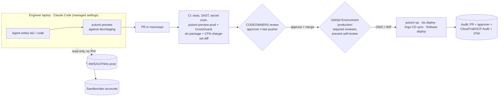

# Papaya — Coding Agents for DevSecOps: Big-Tech Models & Top 3 Solutions

> Role: Principal DevSecOps · Version: **v2 (revised)** · Date: 2026-11-05
> Method: 5 research sub-agents (3× Sonnet, 2× Haiku) → orchestrator synthesis → 3 fact-check sub-agents against primary sources → revision.
> Verification status of every non-obvious claim is in [Appendix B](#appendix-b--verification-status). Remaining ⚠️ items are flagged inline.

### What changed in v2

- **HIPAA (material change):** Anthropic's BAA covers Claude Code on the **Enterprise** plan with HIPAA configuration enabled. The Team plan is not addressed, and Claude Code via Bedrock/Vertex is **explicitly not covered by Anthropic's BAA**. Bedrock's own coverage comes from the AWS BAA. This hardens the "agents never see PHI by default" rule and adds a Phase-0 legal gate.
- **AWS TEAM corrected:** approval happens in the TEAM web app (Slack is notification-only), and there is no conditional auto-approval such as "on-call + incident". Solution 2's broker choice is updated accordingly.
- **Multi-cloud coverage added:** GCP (Vertex AI), k0s, and Firebase Hosting were missing in v1.
- **Added:** a weighted decision matrix, a compliance mapping (ISO 27001:2022 Annex A + HIPAA 164.312), a verified Claude Code managed-settings baseline, and CI prompt-injection risks for Solution 3.
- **Corrected details:** CrossGuard has 4 enforcement levels, Serverless has no built-in diff, the AWS MCP condition key types, and the OWASP ASI titles.

---

## 0. Diagnosis: Papaya's actual problem

| # | Current state | Risk | Applicable framework |
|---|---|---|---|
| 1 | Laptop SSO profile reaches prod, and the agent inherits it | The agent acts as an engineer with prod rights. A prompt injection or a bad command hits prod directly | Google Zero-Touch Prod; AWS "read-only default + JIT" |
| 2 | Permission prompts are turned off | No deterministic control between the model and the shell | OWASP LLM06 Excessive Agency; Claude Code managed settings |
| 3 | MCP servers and plugins are unreviewed | Supply chain, tool poisoning, credential theft | OWASP LLM03 / ASI04 Agentic Supply Chain; MCP security best practices |
| 4 | Long-lived GitHub token and AWS keys in CI secrets | One leak gives persistent, unattributed access | Microsoft SFI; OIDC / Workload Identity Federation |
| 5 | Monitoring is fragmented and on-call is informal | No evidence for ISO A.8.15/A.8.16 or HIPAA 164.312(b); slow detection | Central audit; Google "observable actions" |
| 6 | Production AI agents read partner and member documents | Untrusted input combined with PHI and the ability to change claim state invites prompt injection | Meta "Agents Rule of Two"; lethal trifecta |
| 7 | Coding agents may read PHI (prod logs, DB) and send it to the model provider | HIPAA exposure if the plan or channel isn't covered by a BAA | Anthropic BAA scope; AWS BAA for Bedrock |

**Key point:** the conflict between Engineering and Compliance is not a dilemma. All the big-tech models below resolve it the same way:

> **Agents and humans get broad freedom to *propose* and *observe*; only an attributable pipeline or broker *executes* changes on prod, after a named person approves.**

Engineering gets speed: the agent writes the IaC, runs the preview, debugs read-only, and ships to dev and staging on its own. Compliance gets "a named person who reviewed and approved it" for every prod change. The design problem is making that approval step **fast** and **hard to bypass**.

---

## 1. Top 5 models used at large organizations

### Model 1 — Google: Zero-Touch Prod + Multi-Party Authorization (BeyondProd / BAB)

- **Core idea:** no human holds standing access to prod. Every change goes through automation or small, safe APIs. Sensitive actions need a second person's approval (MPA). Code reaches prod only if it was reviewed and built on an isolated system with provenance (Binary Authorization for Borg).
- **Key controls:**
  - Risk tiering: infra access is always high risk.
  - MPA on *specific actions*, not broad group grants.
  - A proxy for commands that lack fine-grained APIs.
  - Break-glass that is monitored, tested regularly and peer-reviewed every week.
  - Logs that carry a justification (ticket ID).
- **Agent guidance** (Google's paper on secure AI agents): every agent has a clear *human controller*, *limited powers*, and *observable* actions and plans.
- **Transferable:**
  - Default-deny for prod writes.
  - The agent goes through a narrow tool (plan, apply, deploy) instead of a raw shell or the AWS CLI.
  - Link each agent run to its approver and its change.
- **Not worth it at Papaya's scale:** full ZTP, a self-built BAB, hardware trust, and service-mesh mTLS everywhere.
- **Sources:** [BSRS ch.5](https://google.github.io/building-secure-and-reliable-systems/raw/ch05.html) · [BAB](https://docs.cloud.google.com/docs/security/binary-authorization-for-borg) · [Google secure AI agents](https://research.google/pubs/an-introduction-to-googles-approach-for-secure-ai-agents/) · [SAIF agent self-assessment](https://saif.google/agent-risk-self-assessment)

### Model 2 — Amazon/AWS: "Humans don't deploy, pipelines do" + read-only default + JIT

- **Core idea:** code review is the last manual gate. Pipelines deploy in waves (one-box → AZ → region), with bake time and automatic rollback on alarm. People get **read-only by default**, and writes go through JIT: request, approval, then expiry.
- **Key controls:**
  - IAM Identity Center permission sets.
  - [TEAM](https://github.com/aws-samples/iam-identity-center-team):
    - Approvers are Identity Center groups scoped by account or OU, and self-approval is blocked.
    - Maximum duration is set per policy (1–8000h).
    - Each policy has an "Approval required" toggle.
    - **Approval happens in the TEAM web app.** Slack is only a notification channel.
  - Approver ≠ requester, and a different person audits temporary permissions.
  - SCPs and permission boundaries as a backstop.
  - GitHub OIDC with a strict `sub` (e.g. `repo:ORG/REPO:environment:production`) instead of long-lived keys.
- **For agents:**
  - The [Agentic AI Security Scoping Matrix](https://aws.amazon.com/ai/security/agentic-ai-scoping-matrix/) puts a coding agent at **Scope 2: Prescribed Agency**. The agent proposes and a human approves, and enforcement lives outside the model (IAM, SCP, Cedar).
  - The IAM condition keys `aws:ViaAWSMCPService` (Bool) and `aws:CalledViaAWSMCP` (String, e.g. `aws-mcp.amazonaws.com`) let a policy tell agent traffic apart from human traffic.
  - **Limit:** they only apply to calls made through an AWS-managed MCP service. A local MCP server or a CLI call run by Claude Code looks like a direct human call. On laptops, separate roles and session tags are the real control.
- **Transferable:** almost all of it. Papaya is AWS-primary, so this is the most "native" model.
- **Sources:** [Hands-off deployments](https://builder.aws.com/content/3ErTKQOTKc5NIw031UePBPxTQ6I/automating-safe-hands-off-deployments) · [AG.SAD.4 JIT](https://docs.aws.amazon.com/wellarchitected/latest/devops-guidance/ag.sad.4-limit-human-access-with-just-in-time-access.html) · [TEAM docs](https://aws-samples.github.io/iam-identity-center-team/docs/overview/workflow.html) · [IAM condition keys](https://docs.aws.amazon.com/IAM/latest/UserGuide/reference_policies_condition-keys.html) · [GitHub OIDC](https://docs.github.com/en/actions/reference/security/oidc)

### Model 3 — Microsoft: SFI + PIM/JIT with approval + Enterprise Access Model + dedicated agent identities

- **Core idea:** the Secure Future Initiative is secure by design, secure by default, and secure in operations. It removes long-lived secrets, isolates credentials across boundaries, and limits which package endpoints pipelines can reach.
- **Privileged access:**
  - PIM activation requires approval, approvers cannot approve their own requests, and *service principals cannot approve*. Activation is time-bound.
  - The Enterprise Access Model separates the control, management and data planes, and a lower plane never controls a higher one.
- **Agent identity (Entra Agent ID):** agents are a separate identity type. They can *never* hold high-privilege roles (Global Admin, Privileged Role Admin…). Permissions such as `RoleManagement.ReadWrite.All` are blocked, and even an admin cannot consent to them.
- **Transferable:** "**an agent can never grant itself privileges**".
  - Enforce it with an SCP or permission boundary that denies `iam:*`, `organizations:*` and `sso:*` to every session tagged as an agent.
  - Map the planes: AWS Organizations and Identity Center are the control plane (agents never touch it), infra accounts are the management plane, and Aurora plus the claim-document S3 buckets are the data plane (PHI).
- **Sources:** [SFI 07/2026](https://microsoft.com/en-us/security/blog/2026/07/10/securing-our-future-july-2026-progress-report-on-microsofts-secure-future-initiative) · [PIM approval](https://learn.microsoft.com/en-us/entra/id-governance/privileged-identity-management/pim-approval-workflow) · [Entra Agent ID](https://learn.microsoft.com/en-us/entra/agent-id/authorization-agent-id)

### Model 4 — GitOps + Policy-as-Code: "the PR is the only road to prod" (HashiCorp, GitLab, Spacelift/Pulumi ecosystem)

- **Core idea:** plan on the PR, run the policy check, get human review, and apply after merge. The approval is the PR review by a named person, so the audit trail comes for free.
- **Tooling:**
  - **Pulumi CrossGuard:** has 4 levels: `advisory`, `mandatory`, `remediate`, `disabled`.
    - `pulumi preview --policy-pack <dir>` runs on the open-source CLI.
    - Server-side enforcement through policy groups, plus the ready-made packs, require a paid Pulumi Cloud edition.
  - **GitHub rulesets:** "Require approval of the most recent reviewable push", plus CODEOWNERS.
  - **GitHub Environments:** required reviewers (up to 6) plus **Prevent self-review**.
- **Strengths:** cheap, quick to adopt, and direct evidence for ISO 27001 A.8.32 Change management.
- **Weakness:** it only covers changes that go through git. Debugging, incidents and console click-ops fall outside it, and drift detection only detects; it cannot prevent.
- **Sources:** [CrossGuard config](https://www.pulumi.com/docs/iac/crossguard/configuration/) · [Pulumi policy editions](https://www.pulumi.com/docs/insights/policy/) · [GitHub rulesets](https://docs.github.com/en/repositories/configuring-branches-and-merges-in-your-repository/managing-rulesets/available-rules-for-rulesets) · [Environments](https://docs.github.com/en/actions/managing-workflow-runs-and-deployments/managing-deployments/managing-environments-for-deployment)

### Model 5 — Agent containment: Meta "Rule of Two" + GitHub Copilot coding-agent sandbox + OWASP Agentic Top 10 + Claude Code managed settings

- **[Meta Agents Rule of Two](https://ai.meta.com/blog/practical-ai-agent-security/) (31/10/2025):** within one session an agent may have at most **2 of 3** properties:
  - [A] "process untrustworthy inputs"
  - [B] "access to sensitive systems or private data"
  - [C] "change state or communicate externally"

  An agent that needs all three needs human approval or must be split across sessions. Related: Simon Willison's [lethal trifecta](https://simonwillison.net/2025/Jun/16/the-lethal-trifecta/).
- **GitHub Copilot coding agent, as a reference design:**
  - It runs in an ephemeral environment behind a firewall.
  - It only pushes to `copilot/*` branches.
  - Workflows don't run until a human approves them.
  - The agent cannot approve or merge its own PR.
  - ([GitHub docs](https://docs.github.com/en/copilot/concepts/security-governance-and-network-settings/risks-and-mitigations))
- **OWASP:**
  - [LLM Top 10 2025](https://genai.owasp.org/llm-top-10/): LLM01 Prompt Injection, LLM02 Sensitive Information Disclosure, LLM03 Supply Chain, LLM06 Excessive Agency.
  - [Agentic Top 10 2026](https://genai.owasp.org/resource/owasp-top-10-for-agentic-applications-for-2026/): ASI01 Agent Goal Hijack, ASI02 Tool Misuse, ASI03 Identity & Privilege Abuse, ASI04 Agentic Supply Chain Vulnerabilities, ASI05 Unexpected Code Execution, ASI06 Memory & Context Poisoning, ASI09 Human-Agent Trust Exploitation.
- **Claude Code enterprise controls** (the deterministic layer, checked against code.claude.com docs):
  - **Delivery:** server-managed settings come from claude.ai (Organization settings → Claude Code → Managed settings), on the **Team and Enterprise** plans. They can also be delivered by MDM or through `managed-settings.json` (macOS: `/Library/Application Support/ClaudeCode/`, Linux: `/etc/claude-code/`).
  - **Key controls:**
    - `permissions.disableBypassPermissionsMode: "disable"`
    - `allowManagedPermissionRulesOnly`, `allowManagedHooksOnly`
    - `allowManagedMcpServersOnly` + `allowedMcpServers`
    - `strictKnownMarketplaces`
    - `sandbox.*`
    - OpenTelemetry with the endpoint locked in the managed `env` block
  - Section 2 has a concrete baseline.

### Summary comparison

| Model | Strongest at | Weakest at | Fit for Papaya |
|---|---|---|---|
| 1. Google ZTP + MPA | Principles, tiering, break-glass | Very costly at full scale | Borrow the principles, not the implementation |
| 2. AWS pipeline + JIT | AWS-native, cheap, mature | Doesn't cover the agent layer | ★★★★★ |
| 3. Microsoft SFI/PIM/Agent ID | Agent identity, no self-escalation, planes | Azure/Entra-specific tooling | Borrow the principles, implement with IAM/SCP |
| 4. GitOps + PaC | Change-management evidence, low cost | Doesn't cover debug or incidents | ★★★★★ (foundation) |
| 5. Agent containment | Prompt injection, supply chain, laptop agents | Not an access model on its own | ★★★★★ (mandatory) |

---

## 2. Principal assessment: Top 3 solutions for Papaya

The 5 models aren't alternatives to each other; they are building blocks. The 3 solutions below are **3 different operating architectures**, each assembled from those blocks.

### 2.1 Decision matrix

Scores are 1–5; for "Effort", higher means cheaper and faster.

| Criterion (weight) | S1 GitOps-gated | S2 = S1 + JIT broker | S3 Central agent runtime |
|---|---|---|---|
| Compliance strength (25%) | 4 | 5 | 5 |
| Risk reduction (25%) | 4 | 5 | 5 |
| Engineering velocity (20%) | 3 | 4 | 2 |
| Effort / cost (15%) | 5 | 3 | 1 |
| Fit with current stack (15%) | 5 | 4 | 2 |
| **End-state score (/100)** | **82** | **87** | **67** |
| Time to value | 4–6 weeks | +6 weeks after S1 | 3–6 months |

**Reading the matrix:**
- S2 has the highest end-state value, but it is a **superset of S1**. S1 has to exist first, and it delivers the most risk reduction per week. That is why S1 ranks #1 as the starting point and S2 is the 90-day target.
- S3 is the most secure but scores worst on velocity and cost, so it is the long-term direction.

### 🥇 Solution 1 — "Agent proposes, Pipeline disposes" (GitOps-gated agents + hardened agent baseline)

**Combines:** Model 4 (GitOps/PaC), Model 2 (OIDC, read-only default), Model 5 (Claude Code managed baseline), Model 3 (no self-escalation).



**How it works**

1. **Credentials on the laptop:**
   - Prod is reachable only through `ReadOnly-NoPHI`. It denies `s3:GetObject` on the claim-document buckets, `rds-data:*`, `secretsmanager:GetSecretValue`, and `kms:Decrypt` on the PHI keys.
   - Remove every prod write profile from laptops.
   - The agent has full rights in **sandbox and dev accounts**, so Engineering keeps its speed where risk is low.
2. **The only road to prod:**
   - Open a PR. CI runs `pulumi preview` against prod, posts the diff on the PR, and runs CrossGuard with `mandatory` policies: public S3, wildcard IAM, disabled encryption, deleting a DB.
     - Don't use `remediate` on prod: auto-fixing hides the change from the reviewer.
   - Serverless Framework has **no built-in diff**. Run `serverless package`, create a CloudFormation change set from the template, and post it on the PR (custom step). v4 also supports `provider.deploymentMethod: changesets` ⚠️ (still need to verify whether change sets can be left unexecuted for review).
   - Reviews and approvals:
     - Ruleset "Require approval of the most recent reviewable push" + CODEOWNERS (platform and security for `infra/**`).
     - Environment `production` with required reviewers and Prevent self-review.
     - The deploy job assumes the prod role through **OIDC** with `sub = repo:papaya/<monorepo>:environment:production`.
3. **Multi-cloud coverage:**
   - **GCP (Vertex AI/Gemini):**
     - GitHub Actions authenticates with **Workload Identity Federation** (`google-github-actions/auth`), with an attribute condition on repository and environment.
     - Set org policy `iam.disableServiceAccountKeyCreation`.
     - Laptops get only the viewer role on prod projects.
   - **k0s:**
     - A GitOps controller (Argo CD or Flux) pulls manifests from the monorepo.
     - Humans and agents get a read-only kubeconfig (the `view` ClusterRole, which cannot read Secrets).
     - `kubectl exec`, `port-forward` and writes on prod go through JIT (S2).
   - **Firebase Hosting:** replace `FIREBASE_TOKEN` (the `login:ci` token) with a service account federated through WIF.
4. **Agent baseline (managed settings):** push it from the claude.ai admin console, and use MDM for the keys that must be in force before login.
5. **Shorter waits (Engineering's concern):**
   - A review-SLA rotation for platform reviewers.
   - Risk-tiered CODEOWNERS: app config is reviewed by the team, while IAM, network, data stores and KMS need platform plus security.
   - An agent pre-review that summarizes blast radius on the PR. It *only assists*; it is not the named approver.
   - Small PRs.

**Illustrative baseline:** keys verified against the docs on 2026-11-05. Test against the deployed version before rollout.

```json
{
  "forceLoginMethod": "claudeai",
  "forceLoginOrgUUID": "<papaya-org-uuid>",
  "allowManagedPermissionRulesOnly": true,
  "allowManagedHooksOnly": true,
  "allowManagedMcpServersOnly": true,
  "permissions": {
    "disableBypassPermissionsMode": "disable",
    "deny": [
      "Read(~/.ssh/**)", "Read(~/.config/gcloud/**)", "Read(./**/.env*)",
      "Bash(pulumi up *)", "Bash(pulumi destroy *)",
      "Bash(serverless deploy *)", "Bash(sls deploy *)", "Bash(firebase deploy *)",
      "Bash(git push --force *)", "Bash(kubectl delete *)"
    ]
  },
  "allowedMcpServers": [
    { "serverUrl": "https://mcp.internal.papaya.example/*" }
  ],
  "strictKnownMarketplaces": [
    { "source": "github", "repo": "papaya/claude-plugins" }
  ],
  "sandbox": {
    "enabled": true,
    "failIfUnavailable": true,
    "allowUnsandboxedCommands": false,
    "network": {
      "allowManagedDomainsOnly": true,
      "allowedDomains": ["*.amazonaws.com", "*.googleapis.com", "github.com", "*.github.com", "registry.npmjs.org", "pypi.org"]
    },
    "filesystem": { "denyRead": ["~/.ssh", "~/.config/gcloud/legacy_credentials"] }
  },
  "env": {
    "CLAUDE_CODE_ENABLE_TELEMETRY": "1",
    "OTEL_LOGS_EXPORTER": "otlp",
    "OTEL_METRICS_EXPORTER": "otlp",
    "OTEL_EXPORTER_OTLP_PROTOCOL": "grpc",
    "OTEL_EXPORTER_OTLP_ENDPOINT": "https://otel.internal.papaya.example"
  }
}
```

**Design notes:**
- **Use `serverUrl`/`serverCommand`, not `serverName`.** The user picks the name, so it is not a security control.
- **`strictKnownMarketplaces: []` blocks every marketplace,** including the official one.
- **`forceLoginOrgUUID` must come from MDM.** Server-managed settings only arrive after login.
- **`~/.aws` is deliberately not denied in the sandbox.** The agent needs the CLI to debug with the read-only role. Since laptops no longer hold any write profiles, the agent reading the RO token is acceptable (≤1h, no PHI).
- **IAM is the real control; permission rules are defense-in-depth.** A deny rule can be routed around through another tool, but an IAM deny cannot.

**Why it is #1**
- It satisfies both quotes without trading one away. Engineers still "ship their own infra changes" through a PR, and every prod change has a named approver that GitHub records automatically.
- It reuses existing tooling (monorepo, Pulumi, GitHub Actions, Claude Code). No new vendor is needed.
- It closes risks 1, 2, 3, 4 and 7 (via the NoPHI default) in about 4–6 weeks.

**Trade-offs**
| Gain | Cost |
|---|---|
| Strong audit trail, almost free | Every prod change waits for a reviewer, adding lead time (minutes to hours) |
| Low cost, existing tooling | **Doesn't cover incidents or debugging** that need writes (restart ECS, redrive DLQ, scale) |
| The agent never holds prod write credentials, which contains prompt injection | Serverless needs a custom diff step; the server-side CrossGuard features cost money |
| Policy-as-code catches the agent's mistakes | Click-ops in the console sits outside GitOps. Needs drift detection plus an SCP or permission-set deny on console writes in prod |
| Uniform model across AWS, GCP, k0s and Firebase | Reviewer fatigue: many agent PRs lead to rubber-stamping. Needs risk-tiering and small PRs |

---

### 🥈 Solution 2 — S1 + JIT access broker for operations (agent-aware JIT elevation) — **90-day target**

**Combines:** Model 2 (JIT), Model 1 (MPA, break-glass), Model 3 (PIM-style approval, time-boxed), Model 5 (Rule of Two for debug sessions).

**Adds to S1:** an operations path for work that can't go through a PR: incidents, debugging that needs data reads, and one-off runbook actions.

1. **Access tiers** (Identity Center permission sets + k0s RBAC + GCP IAM):

   | Tier | Purpose | TTL | Approval |
   |---|---|---|---|
   | `T0-ReadOnly-NoPHI` | Laptop default | Standing | None |
   | `T1-Operator` | Runbook actions: restart service, redrive DLQ, scale, invalidate cache, `kubectl rollout restart` | 1h | 1 approver; *policy-based auto-approval* if the requester is on-call and has an open incident (needs a broker that supports it) |
   | `T2-DataRead-PHI` | Read PHI **for a specific tenant/country** (ABAC on tags `tenant`, `country`) | 30 min | Security or DPO + ticket + justification |
   | `T3-BreakGlass-Admin` | Emergency | 1h | 2 approvers (MPA), alert to the security channel, mandatory postmortem, weekly review |

2. **Choosing a broker (corrected in v2):**
   - **AWS TEAM:** free and native. But approval is web-app only, it has no conditional auto-approval (only an on/off "Approval required" per policy), and it covers AWS only. A good fit if Compliance doesn't accept auto-approval.
   - **Common Fate / Granted:** CLI-first and approves in Slack. Auto-approval rules (e.g. on-call) and break-glass are written in Cedar. Covers AWS plus GCP. ⚠️ Check current pricing.
   - **Teleport:** if one broker should cover AWS, k0s (kubectl), DBs and SSH. Identity Governance needs Enterprise, so it is the most expensive.
   - **Principal call:** start with **TEAM** for AWS (zero cost, quick to prove the process). Move to Common Fate or Teleport once k0s and GCP JIT become real needs, or once Compliance accepts approval-by-policy.
3. **Making it agent-aware:**
   - Elevated credentials used by an agent session carry the session tags `actor=agent`, `engineer=<id>`, `ticket=<LIN-123>`.
   - An SCP or permission boundary denies `iam:*`, `organizations:*`, `sso:*`, `kms:ScheduleKeyDeletion`, `rds:DeleteDBCluster` and `s3:DeleteBucket` to `actor=agent`. That rules out self-escalation and irreversible actions.
   - **Rule of Two for prod debug sessions:** when the agent reads logs or data on prod, it has [A] untrusted input (logs contain text from partner documents) and possibly [B] sensitive data. It must therefore **not have [C]**: no write role, and egress limited to the AWS endpoints and the model endpoint. To act on what it finds, open a new session with T1, or go back to a PR.
4. **HIPAA gate (corrected in v2), required before opening T2 to agents:**
   - Anthropic's BAA covers Claude Code only on the **Enterprise plan with HIPAA activated**: the Primary Owner accepts the BAA, applies the HIPAA configuration, and members sign in with Enterprise accounts. The **Team plan is not addressed**.
   - Claude Code through **Bedrock/Vertex/a gateway is not covered by Anthropic's BAA**. Bedrock is on AWS's HIPAA-eligible services list, so coverage would come from **Papaya's AWS BAA** ⚠️ (confirm per model in AWS Artifact).
   - **Options:**
     - (a) Upgrade to Enterprise + HIPAA config.
     - (b) Route PHI-touching sessions through Claude on Bedrock under the AWS BAA.
     - (c) **Agents never get T2.** Only humans read PHI.

     Until Legal decides, **(c) is the default**.

**Why #2 (and the target end state)**
- It answers Engineering's real need, "I want to debug… without waiting", which S1 doesn't cover.
- It keeps Compliance's principle: every elevation has a named approver, or an approval-by-policy that a named person signed off in advance, plus expiry and logs.
- It makes on-call formal (risk 5), because elevation is tied to incidents.
- T3 break-glass directly meets HIPAA 164.312(a)(2)(ii) *Emergency access procedure*, a **Required** implementation specification.

**Trade-offs**
| Gain | Cost |
|---|---|
| Covers incidents and debugging, so engineers have no reason to want "standing prod admin" | More moving parts (broker, tier policies, SCPs, Slack): +6 weeks of effort |
| Time-boxed, so a leaked credential has little value | Policy design is easy to get wrong: T1 too broad becomes standing admin; T1 too narrow sends everyone to T3 |
| Agent sessions are tagged, so CloudTrail separates agents from humans | TEAM has no approve-in-Slack and no conditional auto-approval, so the incident experience is slower; upgrading the broker costs money |
| Rule of Two contains prompt injection during debugging | T1 changes are *not in git*. Drift has to be reconciled: the next PR codifies the change or it gets reverted |
| ABAC per tenant/country fits multi-partner contracts | Approval-by-policy needs written acceptance from Compliance |

---

### 🥉 Solution 3 — Centralized Agent Runtime: agents run on managed infrastructure, laptops hold no cloud credentials

**Combines:** Model 5 (Copilot-coding-agent-style sandbox), Model 1 (agent = workload identity, BeyondProd), Model 3 (dedicated agent identity), Model 2 (Scoping Matrix scope 2→3).

**How it works**
- **Runners:** every infra-capable agent task (IaC changes, prod debugging, runbooks) runs on **ephemeral runners**: GitHub Actions with the Claude Code Action, or devcontainers on EC2/k0s pods.
- **Identity:** each task type and environment gets its own **agent identity**, an IAM role or GCP service account obtained through OIDC/WIF.
- **Triggers:** Linear, Slack, or a PR comment.
- **Laptops** hold **no cloud credentials at all**. Claude Code on the laptop only writes code, runs tests and pushes branches.
- **Hardening:**
  - Firewalled egress with an allowlist.
  - Credentials scoped to the task with a 15–60 minute TTL.
  - Full transcripts stored in S3 with Object Lock.
  - MCP servers come only from a container image curated by the platform team.
- **Approval gate:**
  - The agent posts a plan.
  - A named approver approves it through a GitHub Environment.
  - Only then does the job receive write credentials.
- **CI-specific risk (prompt injection in CI):** PR content, issues and comments are all [A] untrusted input.
  - Never use `pull_request_target` combined with checking out the PR head.
  - Only members with write access can trigger the agent.
  - An agent job that reads untrusted content gets a read-only token and no prod credentials. Its output is just a PR, which goes back through S1's gates.

**Why #3**
- **Strongest security:** laptops are removed from the trust boundary, the attack surface is fixed, and evidence is centralized. It also matches where the industry is going (Copilot coding agent, Claude Code GitHub Action, background agents).
- **Too early for Papaya:**
  - The effort is high: runner platform, image pipeline, secret brokering, transcript storage.
  - It breaks the local dev loop.
  - Without the S1/S2 baseline in place, Engineering is likely to bypass it and fall into the "shadow agent" anti-pattern.

**Trade-offs**
| Gain | Cost |
|---|---|
| No credentials on laptops; a lost laptop never touches the cloud | Highest effort (3–6 months) plus a team to operate the runner platform |
| Uniform, reproducible environment with centrally managed MCP | Interactive debugging is slower than local (latency, context) |
| Complete, immutable audit transcripts, strong for HIPAA/ISO | Compute plus background tokens cost more |
| Easy to apply Rule of Two per job type | Runners hold prod roles, which makes them high-value targets; they need isolation and pinned images |
| | The CI attack surface gets bigger (prompt injection through PRs and issues) |

**Principal view:** S3 is the **18-month direction** for *autonomous/background* tasks (dependency upgrades, drift remediation, PRs generated from alerts). It does not replace S1+S2.

---

## 3. Compliance mapping

ISO 27001:2022 Annex A titles come from a secondary source ⚠️; HIPAA text is from 45 CFR 164.312.

| Requirement | S1 | S2 | S3 | Evidence |
|---|---|---|---|---|
| ISO A.5.15 Access control / A.5.18 Access rights | ● | ● | ● | Permission sets, NoPHI role, periodic access review |
| ISO A.8.2 Privileged access rights | ◐ (no standing write) | ● (JIT T1–T3) | ● | Broker logs: requester, approver, TTL |
| ISO A.8.4 Access to source code | ● | ● | ● | Rulesets, CODEOWNERS |
| ISO A.8.9 Configuration management | ● | ● | ● | IaC in git, CrossGuard, drift detection |
| ISO A.8.15 Logging / A.8.16 Monitoring activities | ◐ | ● | ● | CloudTrail + GCP Audit + Claude Code OTel → SIEM |
| ISO A.8.25 Secure development life cycle / A.8.28 Secure coding | ● | ● | ● | CI: SAST, secret scan, policy |
| ISO A.8.31 Separation of dev, test and production | ● | ● | ● | Sandbox accounts for agents, prod read-only |
| ISO A.8.32 Change management | ● | ● (+T1 reconciliation) | ● | PR + approver + environment approval |
| HIPAA 164.312(a)(1) Access control; (a)(2)(i) Unique user identification (Req.) | ● | ● | ● | Per-person SSO, session tags `engineer=` |
| HIPAA 164.312(a)(2)(ii) Emergency access procedure (Req.) | ○ | ● | ● | T3 break-glass runbook + test |
| HIPAA 164.312(b) Audit controls | ◐ | ● | ● | Central audit, retention |
| HIPAA 164.312(d) Person or entity authentication | ● | ● | ● | SSO + MFA; OIDC for workloads |
| HIPAA BAA for PHI sent to the model provider | ● (NoPHI default) | Gate (§2, S2.4) | Gate | Plan/contract decision |

● fully covered · ◐ partially · ○ not covered. Note: the HHS Security Rule NPRM (published 01/2025) **had not been finalized** as of this research ⚠️. Track it, because it may make some currently *addressable* specs mandatory.

---

## 4. Recommendation and roadmap

**Decision:** **S1 is the foundation, S2 is the 90-day target, and S3 is a pilot for background-agent tasks.**

| Phase | Timing | Work | Closes risk |
|---|---|---|---|
| **0 — Stop the bleeding** | Weeks 1–2 | Push the Claude Code managed baseline (server-managed + MDM for `forceLoginOrgUUID`). Move all CI to OIDC (AWS) and WIF (GCP, Firebase), revoke long-lived keys and PATs. Change laptop permission sets to ReadOnly-NoPHI on prod. **Legal decides on the BAA** (Enterprise HIPAA vs Bedrock vs no PHI for agents) | 1, 2, 3, 4, 7 |
| **1 — S1** | Weeks 3–6 | Rulesets + CODEOWNERS + Environment `production` (prevent self-review). `pulumi preview` + CrossGuard mandatory on PRs. Serverless change-set diff. Argo CD/Flux for k0s. Deny console writes on prod. Sandbox accounts for agents | 1, 4, ISO A.8.32 |
| **2 — S2** | Weeks 7–12 | TEAM with tiers T0–T3. Session tags `actor=agent` + SCP blocking agent self-escalation. Break-glass runbook + test + weekly review. On-call rotation tied to JIT. ABAC per tenant for T2 | 5, HIPAA 164.312(a)(2)(ii), (b) |
| **3 — S3 pilot + Rule of Two for prod AI agents** | Months 4–6 | Claude Code Action runner for drift remediation and dependency PRs. Review the claim/FWA/document agents: any agent that reads partner documents must not write claim state directly; writes go through a human or rule gate | 6 |

**Success metrics:**
- 0 long-lived cloud keys.
- 100% of prod changes have approver ≠ last pusher (measured from GitHub + CloudTrail).
- 0 sessions in bypass mode (OTel).
- Median PR→prod lead time < 4h for low-risk changes.
- 100% of T2/T3 requests have a ticket and a review.
- Break-glass tested quarterly.

---

## 5. Open questions for Papaya

1. Will the Claude Code plan move from **Team Premium to Enterprise + HIPAA**? If not, should PHI-touching sessions go through Bedrock under the AWS BAA, or should agents never touch PHI?
2. Is AWS Organizations already split into accounts per env and per tenant/country? This determines how strong the SCPs can be and how far blast radius can be limited.
3. Will Compliance accept *approval-by-policy* (on-call + incident = auto-approve T1)? The answer decides between TEAM and a paid broker.
4. Do laptops have MDM? Without it, `forceLoginOrgUUID` and the managed-mcp file can't be enforced before login.
5. Do insurer partner contracts (VN/TH/HK) require data residency? That affects where agents may read data from and which model endpoint (region) to use.

---

## Appendix A — Research method

| Step | Agent | Model | Output |
|---|---|---|---|
| Research | Google ZTP/BeyondProd/SAIF | Sonnet | Model 1 |
| Research | AWS pipelines/TEAM/OIDC/Scoping Matrix | Sonnet | Model 2 |
| Research | Microsoft SFI/PIM/Agent ID | Haiku | Model 3 |
| Research | Agentic AI frameworks + Claude Code controls | Sonnet | Model 5 |
| Research | GitOps/JIT brokers/ISO-HIPAA | Haiku | Model 4, broker options |
| Fact-check | Claude Code settings + BAA | Sonnet (claude-code-guide) | §2 baseline, HIPAA gate |
| Fact-check | AWS TEAM/IAM keys/GitHub/Pulumi/Serverless | Sonnet | Corrections to Models 2 and 4, S1, S2 |
| Fact-check | OWASP/ISO/HIPAA/Meta | Haiku | §3 mapping, OWASP titles |

## Appendix B — Verification status

| Claim | Status | Source |
|---|---|---|
| Claude Code keys: `disableBypassPermissionsMode: "disable"`, `allowManagedPermissionRulesOnly`, `allowManagedHooksOnly`, `allowManagedMcpServersOnly`, `allowedMcpServers` (serverUrl/serverCommand/serverName), `strictKnownMarketplaces`, `sandbox.*`, `forceLoginOrgUUID` | ✅ Verified | [permissions](https://code.claude.com/docs/en/permissions) · [managed-mcp](https://code.claude.com/docs/en/managed-mcp) · [plugins/org](https://code.claude.com/docs/en/plugins/org) · [sandboxing](https://code.claude.com/docs/en/sandboxing) · [authentication](https://code.claude.com/docs/en/authentication) |
| Server-managed settings on Team + Enterprise | ✅ Verified | [server-managed-settings](https://code.claude.com/docs/en/server-managed-settings) |
| `disableAutoMode`: `permissions.` prefix vs top-level | ⚠️ Docs disagree | permissions vs settings-reference |
| OTel endpoint locked through managed `env`; exporter selectors not locked | ✅ Verified | [monitoring-usage](https://code.claude.com/docs/en/monitoring-usage) |
| Anthropic BAA covers Claude Code on Enterprise + HIPAA config; not via Bedrock/Vertex; Team not addressed | ⚠️ Mostly verified, snapshots disagree on ZDR. Confirm with Anthropic sales | [BAA article](https://privacy.claude.com/en/articles/8114513-business-associate-agreements-baa-for-commercial-customers) |
| Bedrock is HIPAA-eligible under the AWS BAA | ⚠️ Search snippet only; confirm per model in AWS Artifact | [AWS HIPAA eligible services](https://aws.amazon.com/compliance/hipaa-eligible-services-reference) |
| `aws:ViaAWSMCPService` (Bool), `aws:CalledViaAWSMCP` (String), AWS MCP services only | ✅ Verified | [IAM condition keys](https://docs.aws.amazon.com/IAM/latest/UserGuide/reference_policies_condition-keys.html) |
| TEAM: web-app approval, Slack notification-only, no conditional auto-approval | ✅ Verified (no approve-in-Slack is absence of evidence) | [TEAM docs](https://aws-samples.github.io/iam-identity-center-team/docs/guides/admin.html) |
| GitHub OIDC `sub` with environment; Environments Prevent self-review; rule "Require approval of the most recent reviewable push" | ✅ Verified | GitHub docs (links in §1) |
| CrossGuard: 4 levels; local `--policy-pack` free; server-side enforcement paid | ✅ Verified | Pulumi docs (links in §1) |
| Serverless has no built-in diff; v4 `deploymentMethod: changesets` | ◐ Partial | [Serverless deploying](https://www.serverless.com/framework/docs/providers/aws/guide/deploying) |
| OWASP LLM 2025 and Agentic 2026 titles | ✅ Verified | genai.owasp.org |
| ISO 27001:2022 Annex A titles | ⚠️ Secondary source | bastion.tech; verify against ISO/IEC 27001:2022 |
| HIPAA 164.312 structure and Required/Addressable | ✅ Verified (Cornell LII) | [LII](https://www.law.cornell.edu/cfr/text/45/164.312) |
| HHS Security Rule NPRM not yet final | ⚠️ No final rule found; exact status unverified | [reginfo RIN 0945-AA22](https://www.reginfo.gov/public/do/eAgendaViewRule?RIN=0945-AA22) |
| Meta Rule of Two (31/10/2025, wording of [A][B][C]) | ✅ Verified | [Meta AI blog](https://ai.meta.com/blog/practical-ai-agent-security/) |
| Common Fate / Teleport pricing and features | ⚠️ Not fetched from primary sources | — |
